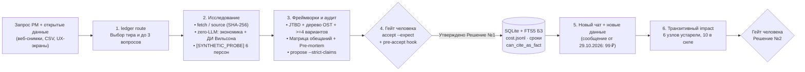
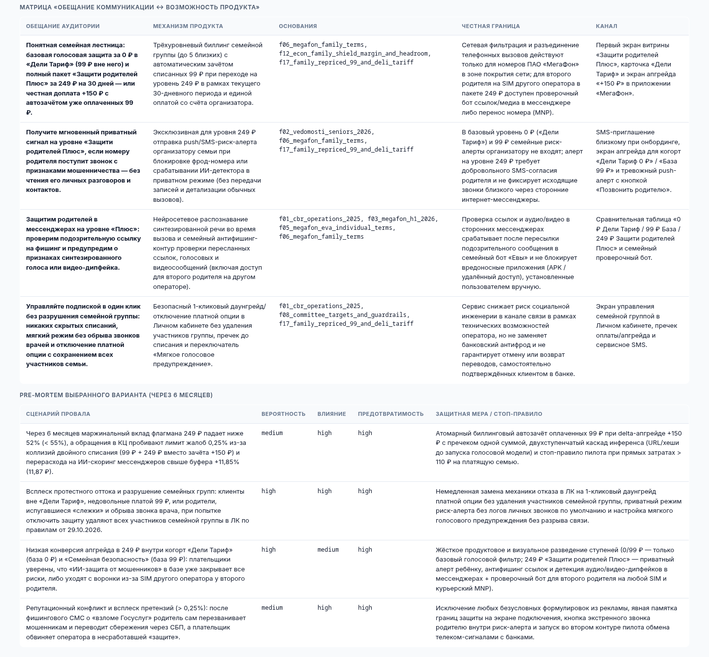

<p align="center">
  
</p>

<p align="center">
  <a href="#запуск-за-5-минут">Запуск за 5 минут</a> ·
  <a href="demo/antifraud-subscription/README.md">Основное демо (открытые данные)</a> ·
  <a href="docs/architecture.md">Архитектура и MCP</a> ·
  <a href="docs/benchmark.md">Бенчмарк и полная стоимость</a> ·
  <a href="docs/portability.md">Переносимость между IDE</a>
</p>

---

**Decision Ledger** — переносимый репозиторий ИИ-агента для руководителя цифрового продукта, разработанный для номинации **«ИИ-проект» («Стратег Фабрики продуктов» от МегаФона) MGIMO×AI Challenge 2026**.

Агент открывается как папка проекта в любой агентной IDE (**Cursor, Codex, Antigravity, Claude Code, Windsurf, OpenCode, GigaCode**) и проводит задачу от размытого бизнес-запроса и открытых данных до выбора между альтернативами, согласованных **продуктовой и коммуникационной стратегий**, дерева возможностей (**OST**), **Pre-mortem** и плана проверки — а после утверждения решения хранит снимки источников по `SHA-256`, контролирует обязательства команды и в новых сеансах пересматривает только те выводы, которые затронуты свежими данными.

---

## Основной демонстрационный проект (100% открытые источники)

Поскольку отдельный демонстрационный бриф партнёра не публиковался, основной сквозной кейс собран на реальной продуктовой задаче экосистемы безопасности ПАО «МегаФон» (**«Моя безопасность +» 149 ₽ / 30 дн. и «Семейная безопасность +» 249 ₽ / 30 дн. поверх ассистента «Ева» — стратегия на 2027 год**) исключительно по открытым данным Банка России, «Ведомостей», публичной отчётности и сайтов операторов:

- **Витрина и разбор 3 шагов демо**: [demo/antifraud-subscription/README.md](demo/antifraud-subscription/README.md) (собрано субагентами одной сессии Antigravity; протокол живого прогона в новых чатах — [docs/live-run.md](docs/live-run.md))
- **Итоговая продуктовая стратегия (Решение №2)**: [strategy-product.md](demo/antifraud-subscription/strategy-product.md) · [strategy-product.pdf](demo/antifraud-subscription/strategy-product.pdf)
- **Итоговая коммуникационная стратегия (Решение №2)**: [strategy-comms.md](demo/antifraud-subscription/strategy-comms.md) · [strategy-comms.pdf](demo/antifraud-subscription/strategy-comms.pdf)
- **Интерактивный HTML-паспорт решения**: [decision-passport.html](demo/antifraud-subscription/decision-passport.html) · журнал затрат [cost.jsonl](demo/antifraud-subscription/cost.jsonl)
- **Вымышленные учебные кейсы для проверки переносимости** (не открытые данные): резервный канал для розничных касс ([demo/retail-continuity/README.md](demo/retail-continuity/README.md)) и фильтрация нежелательных вызовов ([examples/call-filter/scenario-notes.md](examples/call-filter/scenario-notes.md))

---

## Почему обычный диалог с LLM здесь ошибается — и что делает Decision Ledger

| Задача руководителя продукта | Обычный чат с языковой моделью | Decision Ledger (агент + детерминированное ядро) |
| --- | --- | --- |
| **Проверка цифр, интервалов и юнит-экономики** | Считает в тексте промпта: легко пропускает, что при сценарных допущениях (CAC `260 ₽`, удержание `5 мес.` — **допущения**, не факты) тир `149 ₽` даёт `39,6% < 55%`, и ловушку малых выборок (`0/20` -> потолок ДИ Вильсона `16,11%`) | `ledger economics` и `ledger rates --ci` считают маржу, запас прочности, 95% ДИ Вильсона и парадокс Симпсона детерминированно вне окна LLM (`zero_llm` тир) |
| **Связь обещаний маркетинга с границами продукта** | Легко пропускает слоганы про «100% защиту» и смешивает ответы ИИ-персон с рыночными фактами | `audit-claims` + `pre-accept` хук проверяют матрицу «Обещание ↔ Механизм ↔ Граница» и блокируют опору на `synthetic` как на доказательство спроса |
| **Продуктовая глубина вместо общих слов** | Генерирует линейный список идей без структуры допущений и стоп-правил | Валидирует `JTBD` (плательщик vs пользователь), **Opportunity Solution Tree**, **Pre-mortem** Клейна и минимум 3–5 альтернатив (`keep` / `change` / `close`) с возражениями |
| **Продолжение после перерыва и выход новых данных** | Требует вручную копировать старый отчёт (`43 КБ`, [chat-session-1.md](demo/antifraud-subscription/baseline/chat-session-1.md)) в новый чат и переписывает весь текст; машинного графа зависимостей нет (полнота пересмотра не измерялась) | Восстанавливает состояние из `case.sqlite3` (CLI и MCP); после новости МегаФона от `29.10.2026` (`99 ₽` вне «Дели Тариф») помечает ровно `6` устаревших выводов из `16`, сохраняя `10` макрофактов без пересчёта |
| **Затраты и проверяемость (замер 17.11.2026)** | Контроль без ledger: 2 шага, `666 с`, `754 706` входных / `46 401` выходных токенов; `9,8%` абзацев с локаторами (`18/184`) | 3 шага демо: `2 470 с`, `5 136 186` входных / `119 357` выходных токенов, `89` вызовов инструментов; `100%` оснований со снимками `SHA-256` (`17/17`). Все прогоны — субагенты одной сессии Antigravity; модель в журнале не указана; работа в квоте подписки, поэтому **₽ не рассчитываются**; время человека **не измерялось**. Объёмы задач разные — вывод «дешевле в N раз» не делается ([docs/benchmark.md](docs/benchmark.md)) |

---

## Сквозной рабочий процесс (Workflow)



---

## Визуальный обзор ключевых артефактов

### 1. Разбор реальных лендингов и обнаружение устаревших оснований в новом чате
Во втором и третьем сеансах агент восстанавливает контекст из `case.sqlite3`. После регистрации официальной новости МегаФона от `29.10.2026` о переводе базовой «Семейной безопасности» на `99 ₽ / 30 дн.` вне «Дели Тариф» паспорт автоматически подсвечивает только затронутую цепочку выводов и вариантов:


### 2. Дерево возможностей (OST), JTBD, матрица обещаний и Pre-mortem в паспорте Решения №2
Каждый продуктовый метод превращён в проверяемый артефакт в `decision-passport.html`, связанный с конкретными `findings` и проходящий проверку `audit-claims`:




---

## Запуск за 5 минут

### Зависимости, доступы и платные сервисы
- **Обязательные зависимости**: только **Python 3.11+** (стандартная библиотека, **`0` внешних пакетов `pip`**).
- **Платные сторонние API и секреты**: **не требуются** (`0` ключей в репозитории). Аналитическое ядро, веб-снимки `fetch`, база знаний SQLite FTS5, HTML-паспорт и `stdio` MCP-сервер работают локально и бесплатно; языковую модель предоставляет любая выбранная вами агентная IDE по вашей штатной подписке.

### Шаг 1. Проверка чистого клона из терминала (30 секунд, без модели)

```sh
# Запуск 31 модульного и сквозного автотеста + скан секретов и ПДн по всей истории git
make check

# Или напрямую через стандартный интерпретатор Python 3.11+:
python3 -W error::ResourceWarning -m unittest discover -s tests -v
python3 -m ledger audit-repo . --history

# Детерминированный расчёт юнит-экономики и порогов смены решения (тестовая фикстура; планы кейса агент собирает сам)
python3 -m ledger economics tests/fixtures/economics_reference.json

# Когортный расчёт с 95% ДИ Вильсона и проверкой защитных порогов на CSV
python3 -m ledger rates examples/retail-backup/later/recount.csv \
  --group group --segment cohort --denominator drills \
  --numerators network_recovered checkout_completed false_success \
  --ci --guardrail "checkout_completed>=0.90" --guardrail "false_success<=0.03"
```

### Шаг 2. Сквозной запуск агента в IDE (4 минуты)

Откройте корень репозитория в **Cursor** (`.cursor/rules/`, `.cursor/mcp.json`), **Claude Code** (`CLAUDE.md`, `.mcp.json`), **Codex CLI**, **Antigravity**, **Windsurf** или **OpenCode** (`AGENTS.md`, `.agents/skills/`):

1. **Сеанс 1 (новый чат — постановка, поиск вариантов агентом, стоп перед гейтом)**:
   ```text
   Помоги подготовить решение на 2027 год по подпискам защиты от спама и мошенников.
   Возьми запрос из examples/antifraud-subscription/brief.md, сохрани кейс в .cases/antifraud.
   Сначала задай только те вопросы, которые меняют рекомендацию.
   ```
   Передайте ответы из [examples/antifraud-subscription/manager.md](examples/antifraud-subscription/manager.md) — там только рамки и ограничения (минимум 3 разных направления, включая «оставить как есть» и «закрыть»), готового списка вариантов нет. Агент соберёт открытые источники из `examples/antifraud-subscription/initial/` (в `economics_2027.json` — только цены и допущения затрат, без готовых планов), сам предложит варианты, посчитает экономику, построит OST/JTBD/Pre-mortem и остановится перед гейтом выбора человека.

   > **Честно о собранном демо**: в `demo/antifraud-subscription/` использована прежняя версия `manager.md` (коммит `9aab602`), где **все 5 стратегических направлений перечислил руководитель**. Агент их конкретизировал (цены `299 ₽` со страховкой и `180 ₽` опт для B2B2C, возражения, тесты OST) и после новости от 29.10.2026 перестроил вариант (2) в лестницу `0 / 99 / 249 ₽` с доплатой `+150 ₽`. Самостоятельный поиск вариантов агентом проверяется живым прогоном по [docs/live-run.md](docs/live-run.md).
2. **Сеанс 2 (новый чат — утверждение выбора и выпуск стратегий)**:
   ```text
   Открой сохранённый кейс .cases/antifraud. Комитет утверждает рекомендованный тобой вариант —
   зафиксируй Решение №1, проиндексируй в базу знаний и собери паспорт.
   ```
3. **Сеанс 3 (новый чат — пересмотр при поступлении новых данных)**:
   ```text
   Открой .cases/antifraud. Вышло сообщение об изменении условий «Семейной безопасности» от 29.10.2026
   (examples/antifraud-subscription/later/megafon_family_change_20261029.md). Покажи, какие выводы
   устарели транзитивно, и подготовь пересмотренное Решение №2.
   ```

---

## Живой прогон 18.11.2026 · Grok Build CLI (измерено)

Протокол [docs/live-run.md](docs/live-run.md) прогнан в трёх новых сеансах на чистой копии коммита `7ba0640`. Использовался headless-режим Grok Build CLI v1.0.77, модель `grok-4.7` (`grok-4.7-build`). Терминал записан asciinema. Сырые логи, промпты, записи и аудит лежат в [demo/antifraud-subscription/runs/2026-11-18-live-grok-cli/](demo/antifraud-subscription/runs/2026-11-18-live-grok-cli/), честные оговорки — в [HONESTY.md](demo/antifraud-subscription/runs/2026-11-18-live-grok-cli/HONESTY.md).

**Изоляция данных.** Агенту не дали `demo/`, `tests/`, протоколы и прежние ответы. `manager.md` добавлен отдельным коммитом только после вопросов агента. Новость от 29.10.2026 (`later/`) добавлена отдельным коммитом перед Чатом №3.

| Ход | Время (МСК) | Длительность | Оценка CLI, USD* | Итог |
|---|---|---|---|---|
| Чат №1: вопросы | 01:30:52–01:35:19 | 267 с | 0.427398 | вопросы руководителю |
| Чат №1: ответы `manager.md` | 01:37:55–02:20:51 | 2576 с | 3.248650 | 4 варианта, найденные агентом: `keep_shelf`, `explicit_consent`, `scale_family`, `close_paid`; рекомендован `explicit_consent` |
| Чат №1: стоп перед гейтом | 02:20:51–02:23:33 | 162 с | 1.291428 | черновик SHA `dd944b1e…a8f4`, `approved = null` |
| Чат №2: утверждение | 02:37:02–02:39:26 | 144 с | 0.447214 | агент сам вызвал `accept`: Решение №1 `explicit_consent`, SHA `dd944b1e…a8f4` |
| Чат №3: новость 29.10 | 02:39:47–03:05:08 | 1521 с | 3.661416 | черновик Решения №2 SHA `e15c1b21…4529`; цена 99 ₽ ниже порога 55%; семейная закупка заморожена до сверки SKU |
| Чат №3: утверждение | 03:39:00–03:40:03 | 63 с | 0.839434 | `accept`: Решение №2 `explicit_consent`, SHA `e15c1b21…4529` |
| **Итого** | | **4733 с ≈ 78,9 мин** | **9.915540** | 144 вызова модели, выход 224 066 токенов |

\* `total_cost_usd` — оценка самого CLI по токенам. С карты ничего не списывалось: прогон шёл в лимитах подписки. Учтены ли в этой сумме токены субагентов, по логам не видно.

**Что делал человек.** Сообщения в CLI отправлял ассистент-оператор:
- промпты — дословно из `docs/live-run.md`;
- ответы на вопросы — дословные цитаты из `manager.md`, а где ответа нет — просьба принять консервативное допущение;
- оба утверждения — собственные слова Артёма Маланина («Утверждаю explicit_consent», «Утверждаю Решение №2»), вписанные дословно.

Минуты человека не измерялись.

**Оговорки.** В Чате №3 субагент-скептик один раз просмотрел каталог уровнем выше копии и увидел имена придержанных файлов. Ни одного из них он не открыл. Вариант черновика к тому моменту уже был собран. Подробности и проверка по логам — в HONESTY.md.

---

## Устройство репозитория

```text
decision-ledger/
├── AGENTS.md, CLAUDE.md             # Постоянные правила, эпистемика, запрет prompt injection
├── .cursor/, .claude/, .mcp.json    # Нативные правила, хуки и конфигурации stdio MCP-сервера
├── .agents/skills/                  # 6 модульных навыков (problem-framing, product-frameworks и др.)
├── agents/                          # 3 ролевых субагента (evidence-extractor, synthetic-respondent, skeptic)
├── playbook/                        # Методики: contract, research, decision, follow-up, jtbd, ost, premortem, promise-matrix
├── ledger/                          # Ядро на Python 3.11+ stdlib (0 внешних pip-зависимостей):
│   ├── store.py, review.py          #   Транзакционный SQLite со снимками SHA-256 и графом impact
│   ├── stats.py, table.py           #   95% ДИ Вильсона, guardrails, парадокс Симпсона
│   ├── economics.py, cost.py        #   Юнит-экономика с порогами смены решения + учёт затрат cost.jsonl (замер / оценка / подписка)
│   ├── claims.py, web_fetch.py      #   Аудит обещаний, карантин инъекций и HTTPS-снимки страниц
│   ├── kb.py, router.py             #   SQLite FTS5 база знаний (can_cite_as_fact) и маршрутизатор сбоев
│   ├── dashboard.py, mcp_server.py  #   Интерактивный HTML-паспорт и JSON-RPC 2.0 MCP-сервер (9 тулов)
│   └── repo_audit.py, benchmark_eval.py # Скан секретов/ПДн по всей git-истории и рубрика бенчмарка (только измеренные поля)
├── demo/antifraud-subscription/     # Основной демо-проект на открытых данных (стратегии MD/PDF, паспорт, cost.jsonl)
├── demo/retail-continuity/          # Вымышленный учебный кейс для проверки переносимости (B2B-продукт, когортные CSV)
├── examples/                        # Входные данные: antifraud (открытые источники); retail-backup и call-filter — вымышленные учебные кейсы
├── docs/                            # Спецификации: architecture.md, benchmark.md, portability.md
└── tests/                           # 31 модульный и сквозной автотест
```

---

## Честные границы и ограничения системы

- **Смысловая экспертиза остаётся за руководителем продукта**: CLI и MCP гарантируют целостность снимков `SHA-256`, точность арифметики/интервалов, связность графа зависимостей и блокировку безусловных рекламных обещаний, но полноту продуктовых гипотез и причинную интерпретацию оценивает человек на гейте `accept`.
- **Модельные респонденты не измеряют реальный спрос**: ответы синтетических персон (`synthetic: true`, `can_cite_as_fact: false`) применяются только для поиска барьеров восприятия и стресс-теста текстов; реальную конверсию в оплату проверяет полевой пилот со стоп-правилами.
- **Реактивная модель сопровождения**: проверка просроченных поручений `actions` и изменившихся источников выполняется при обращении к кейсу (`status` / `route` / `fetch`), без постоянно запущенного фонового демона.
- **Когда агент избыточен**: для разовых пятиминутных вопросов без таблиц, внешних источников и последующего возврата к решению обычный чат быстрее; `Decision Ledger` создан для защищаемых решений комитета, живущих во времени.
