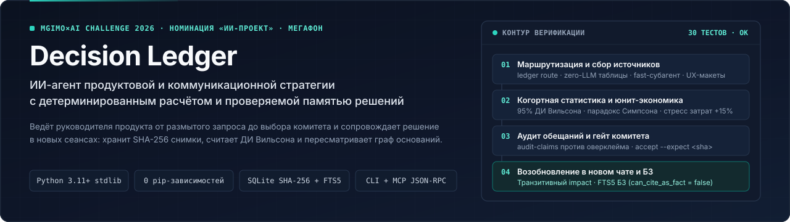
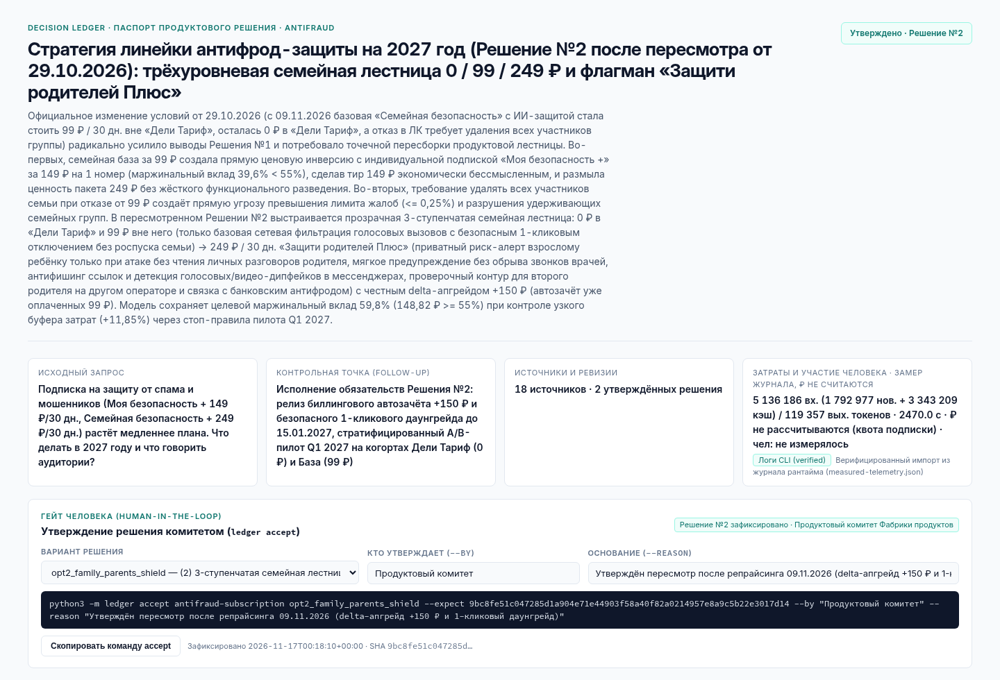
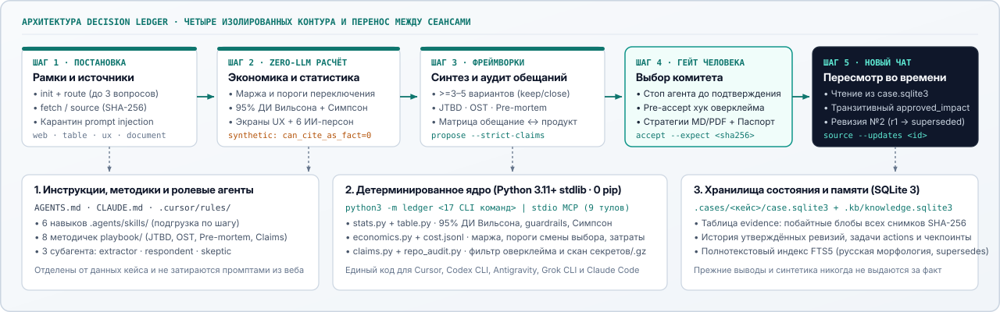
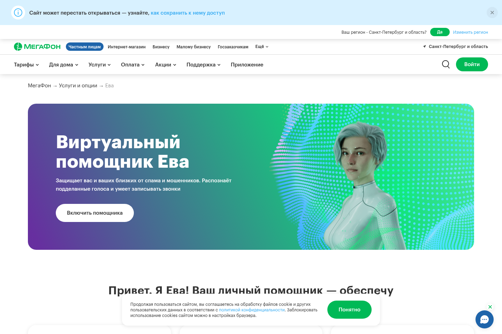
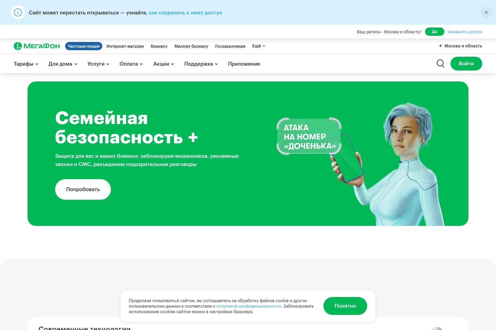
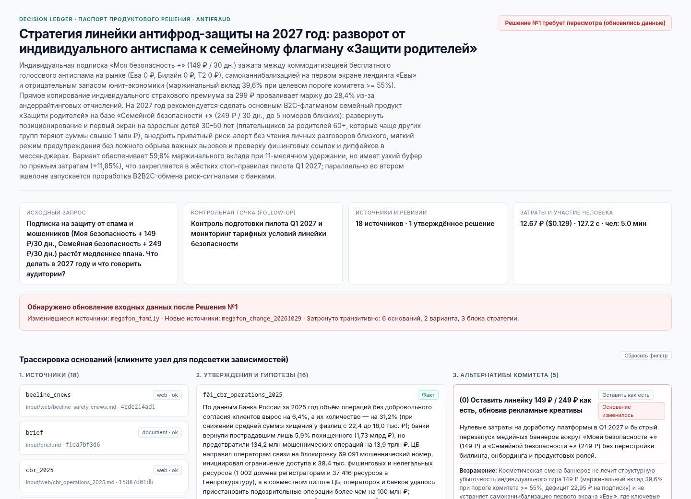
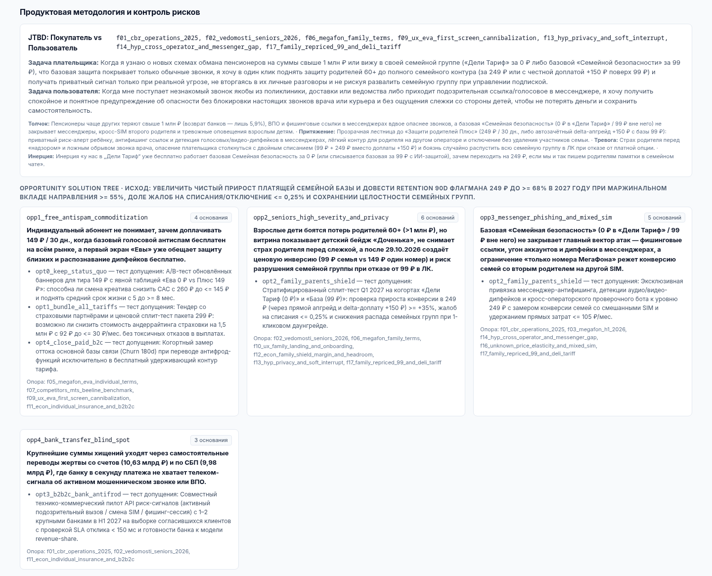
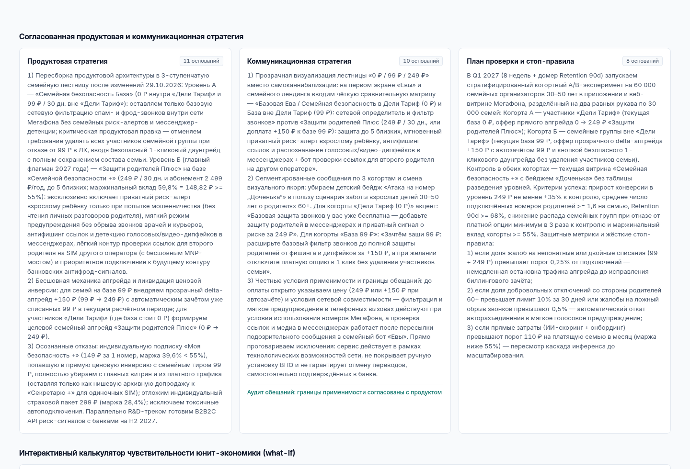
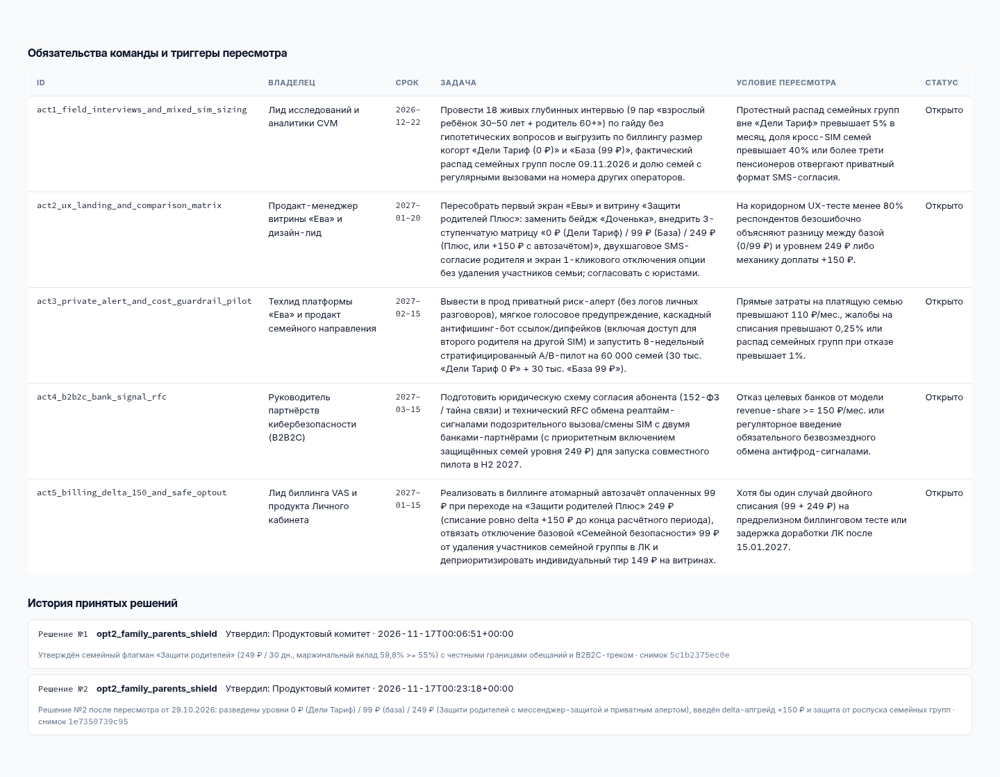

<p align="center">
  
</p>

<h1 align="center">Decision Ledger</h1>

<p align="center">
  <b>ИИ-стратег продуктового комитета в рабочей папке IDE</b> — ведёт от сырого запроса и открытых данных до расчёта юнит-экономики с порогами смены решения, согласованных продуктовой и коммуникационной стратегий и точечного пересмотра выводов в новых чатах.<br/>
  <sub><i>MGIMO×AI Challenge 2026 · Номинация «ИИ-проект» («Стратег Фабрики продуктов» ПАО «МегаФон»)</i></sub>
</p>

<p align="center">
  
  
  
  
  
</p>

<p align="center">
  <a href="https://github.com/artemmalanin979-create/decision-ledger/actions/workflows/ci.yml"></a>
  
  
  
</p>

<p align="center">
  <a href="demo/antifraud-subscription/README.md"><b>Основное демо (Безопасность)</b></a> ·
  <a href="demo/megakino-plus-2027/README.md"><b>2-й открытый кейс (МегаКино / 376-ФЗ)</b></a> ·
  <a href="demo/antifraud-subscription/strategy-product.pdf"><b>Продуктовая стратегия (PDF)</b></a> ·
  <a href="demo/antifraud-subscription/strategy-comms.pdf"><b>Коммуникационная стратегия (PDF)</b></a> ·
  <a href="demo/antifraud-subscription/runs/2026-11-18-live-grok-cli/HONESTY.md"><b>Живой прогон 18.11 (Grok CLI)</b></a> ·
  <a href="docs/architecture.md">Архитектура и MCP</a> ·
  <a href="docs/benchmark.md">Бенчмарк</a> ·
  <a href="docs/portability.md">Переносимость</a>
</p>

<p align="center">
  
</p>

<p align="center">
  
</p>

<p align="center">
  <sub><i>Реальный экспорт интерактивного паспорта <a href="demo/antifraud-subscription/decision-passport.html">decision-passport.html</a> (Решение №2 по линейке безопасности ПАО «МегаФон» на 2027 год): клик по любому источнику, выводу или альтернативе подсвечивает связанную цепочку доказательств. Затраты в шапке отражают фактическую телеметрию логов хоста без домысливания рублей подписки и минут человека.</i></sub>
</p>

> [!NOTE]
> **Decision Ledger** — не автономный «чёрный ящик» и не одноразовый промпт, а переносимая **папка проекта для агентных IDE** (`Cursor`, `Codex CLI`, `Antigravity`, `Grok Build CLI`, `Claude Code`, `Windsurf`, `OpenCode`). Языковая модель ведёт исследование, задаёт не более 3 меняющих решение вопросов и синтезирует аргументы, а детерминированное ядро `ledger/` на стандартной библиотеке Python считает юнит-экономику и интервалы Вильсона, хранит побайтные снимки источников по `SHA-256`, блокирует невыполнимые рекламные обещания и в новых чатах точечно находит выводы, устаревшие после выхода свежих данных.

---

## Содержание

- [С чего начать (маршрут проверки за 2 минуты)](#с-чего-начать-маршрут-проверки-за-2-минуты)
- [Карта основных файлов и артефактов](#карта-основных-файлов-и-артефактов)
- [Подсистемы и возможности: почему обычный чат здесь ошибается](#подсистемы-и-возможности-почему-обычный-чат-здесь-ошибается)
- [Стек и сквозная архитектура](#стек-и-сквозная-архитектура)
- [Демонстрационный проект ПАО «МегаФон» (100% открытые данные)](#демонстрационный-проект-пао-мегафон-100-открытые-данные)
- [Живой прогон 18.11.2026 · Grok Build CLI (измерено)](#живой-прогон-18112026--grok-build-cli-измерено)
- [Быстрый старт за 5 минут из чистого клона](#быстрый-старт-за-5-минут-из-чистого-клона)
- [Структура репозитория](#структура-репозитория)
- [Что доказано и честные границы системы](#что-доказано-и-честные-границы-системы)

---

## С чего начать (маршрут проверки за 2 минуты)

1. **Прочитать готовые стратегии для комитета (открытые данные МегаФона, ЦБ РФ и «Ведомостей»)** → продуктовая стратегия [strategy-product.pdf](demo/antifraud-subscription/strategy-product.pdf) ([.md](demo/antifraud-subscription/strategy-product.md)) и коммуникационная стратегия [strategy-comms.pdf](demo/antifraud-subscription/strategy-comms.pdf) ([.md](demo/antifraud-subscription/strategy-comms.md)).
2. **Открыть интерактивный паспорт решения и граф пересмотра после новости от 29.10.2026** → [decision-passport.html](demo/antifraud-subscription/decision-passport.html) и разбор по шагам в [demo/antifraud-subscription/README.md](demo/antifraud-subscription/README.md).
3. **Проверить чистый живой прогон в 3 отдельных сеансах терминала (без подсказок и без `demo/`)** → таблица таймингов [ниже](#живой-прогон-18112026--grok-build-cli-измерено), сырые логи, `asciinema`-касты и аудит изоляции в [HONESTY.md](demo/antifraud-subscription/runs/2026-11-18-live-grok-cli/HONESTY.md).
4. **Прогнать автотесты и детерминированное ядро локально за 30 секунд (`0` установок `pip`, `0` API-ключей)** → `make check` ([инструкция ниже](#быстрый-старт-за-5-минут-из-чистого-клона)).

---

## Карта основных файлов и артефактов

**Легенда типов артефактов** (применяется сквозно по всему репозиторию):
`СТРАТЕГИЯ` — читаемый управленческий документ для комитета (`MD` / `PDF` / `HTML`) ·
`ЯДРО` — исполняемый код Python 3.11+ stdlib, покрытый автотестами ·
`КОНТРАКТ` — системные правила, навыки, методички и ролевые субагенты ·
`ДАННЫЕ` — открытые первоисточники с URL/датами или явно помеченные учебные стенды ·
`ПРОТОКОЛ` — сырые логи, касты терминала и телеметрия реальных запусков.

| Путь в репозитории | Назначение и что внутри | Тип |
| --- | --- | --- |
| [`demo/antifraud-subscription/README.md`](demo/antifraud-subscription/README.md) | **Витрина основного демо-кейса**: постановка, таблица 18 открытых источников с `SHA-256`, ход 3 шагов и телеметрия | `СТРАТЕГИЯ` |
| [`demo/antifraud-subscription/strategy-product.md`](demo/antifraud-subscription/strategy-product.md) · [`.pdf`](demo/antifraud-subscription/strategy-product.pdf) | **Итоговая продуктовая стратегия 2027 (Решение №2)**: резюме комитета, JTBD, дерево OST, 5 альтернатив, пороги смены выбора, Pre-mortem, пилот Q1 | `СТРАТЕГИЯ` |
| [`demo/antifraud-subscription/strategy-comms.md`](demo/antifraud-subscription/strategy-comms.md) · [`.pdf`](demo/antifraud-subscription/strategy-comms.pdf) | **Итоговая коммуникационная стратегия 2027 (Решение №2)**: разбор живых лендингов «Было → Стало», офферы 3 когорт, CVM-триггеры, матрица обещаний и стоп-лист | `СТРАТЕГИЯ` |
| [`demo/antifraud-subscription/decision-passport.html`](demo/antifraud-subscription/decision-passport.html) | Самодостаточный интерактивный HTML-паспорт Решения №2 (трассировка графа оснований, **ползунки чувствительности `what-if`** CVM vs платный `CAC` по формулам `economics.py`, **панель гейта `accept`**, OST, матрица обещаний) | `СТРАТЕГИЯ` |
| [`demo/megakino-plus-2027/`](demo/megakino-plus-2027/README.md) · [`examples/megakino-plus-2027/`](examples/megakino-plus-2027/README.md) | **Второй реальный открытый кейс вне антифрода** («МегаКино» `399 ₽` / «МегаФон Плюс» `345–460 ₽` / `376-ФЗ`): живые веб-снимки от `19.11.2026`, книга `.xlsx`, черновики `draft.yaml` (`20,7 мин` 1-й проход), верифицированные логи `logs/*.jsonl.gz`, паспорт и `strategy-*.pdf` | `СТРАТЕГИЯ` |
| [`demo/antifraud-subscription/04-impact-after-20261029.json`](demo/antifraud-subscription/04-impact-after-20261029.json) | Детерминированный расчёт области пересмотра после новости МегаФона от `29.10.2026` (`6` из `16` узлов устарели, `10` сохранены) | `ПРОТОКОЛ` |
| [`demo/antifraud-subscription/runs/2026-11-18-live-grok-cli/`](demo/antifraud-subscription/runs/2026-11-18-live-grok-cli/) | **Чистый живой прогон в 3 новых чатах (`grok-4.7`)**: `turns.jsonl`, `logs/*.stream.jsonl.gz`, `casts/*.cast.gz`, выгруженные стратегии `case/strategy-*.pdf`, верифицированный `cost.jsonl` (`--from-log`) и [`HONESTY.md`](demo/antifraud-subscription/runs/2026-11-18-live-grok-cli/HONESTY.md) | `ПРОТОКОЛ` |
| [`examples/antifraud-subscription/`](examples/antifraud-subscription/) | Входные материалы открытого кейса: `brief.md`, рамки `manager.md` (без списка вариантов), 9 веб-снимков, таблица тарифов, data-only `economics_2027.json`, 2 скриншота лендингов, гайд интервью и 6 ИИ-персон | `ДАННЫЕ` |
| [`AGENTS.md`](AGENTS.md) · [`CLAUDE.md`](CLAUDE.md) · [`.cursor/`](.cursor/) · [`.mcp.json`](.mcp.json) | Корневой системный контракт эпистемики и безопасности + нативные правила и конфигурации `stdio MCP` для IDE | `КОНТРАКТ` |
| [`.agents/skills/`](.agents/skills/) · [`agents/`](agents/) · [`playbook/`](playbook/) | 6 процедурных навыков по шагам, 3 ролевых субагента (`evidence-extractor`, `synthetic-respondent`, `skeptic-reviewer`) и 8 методичек (`JTBD`, `OST`, `Pre-mortem`, `Promise Matrix`) | `КОНТРАКТ` |
| [`ledger/`](ledger/) | Детерминированное ядро: SQLite-реестр `store.py`, граф `review.py`, ДИ Вильсона и Симпсон `stats.py`/`table.py`, `.xlsx`-ридер `xlsx.py`, YAML-компилятор `draft_template.py`, экономика `economics.py`, лог-телеметрия `cost.py`, паспорт с `what-if` и `accept` `dashboard.py`, экспорт MD/PDF `strategies.py`, чекер `claims.py`, FTS5 БЗ `kb.py`, `mcp_server.py` (`12` тулов), `repo_audit.py` | `ЯДРО` |
| [`docs/architecture.md`](docs/architecture.md) · [`docs/benchmark.md`](docs/benchmark.md) · [`docs/portability.md`](docs/portability.md) · [`docs/live-run.md`](docs/live-run.md) | Внутреннее устройство, методика полной стоимости и 6-осевого бенчмарка, матрица переносимости между IDE и протокол живого прогона | `КОНТРАКТ` |
| [`demo/retail-continuity/`](demo/retail-continuity/README.md) · [`examples/call-filter/`](examples/call-filter/scenario-notes.md) | Два **вымышленных учебных кейса на синтетических данных** для проверки доменной переносимости ядра (включая `export-strategies`) без правки кода | `ДАННЫЕ` |
| [`tests/`](tests/) · [`.github/workflows/ci.yml`](.github/workflows/ci.yml) | 39 модульных и сквозных автотестов (`unittest`, `0` внешних пакетов) + матричный CI на Python `3.11 / 3.12 / 3.13` со сканом всей истории git, `.gz` и `.xlsx` | `ЯДРО` |

---

## Подсистемы и возможности: почему обычный чат здесь ошибается

| Задача руководителя продукта | Обычный диалог с языковой моделью | Что делает Decision Ledger |
| --- | --- | --- |
| **Проверка цифр, интервалов и юнит-экономики** | Считает в тексте промпта: легко пропускает, что при сценарных допущениях (`CAC 260 ₽`, удержание `5 мес.` — **допущения**, не факты) тир `149 ₽` даёт `39,6% < 55%`, и ловушку малых выборок (`0/20` → верхняя граница 95% ДИ Вильсона `16,11%`) | [`ledger/economics.py`](ledger/economics.py) и [`ledger/stats.py`](ledger/stats.py) считают маржу, запас по костам, аналитические пороги смены выбора (`switching thresholds`), 95% ДИ Вильсона и парадокс Симпсона строго в Python (`zero_llm` тир, `0 ₽`) |
| **Согласование обещаний маркетинга с продуктом** | Пропускает рекламные формулировки про «100% защиту» и смешивает реплики ИИ-респондентов с рыночными фактами | [`ledger/claims.py`](ledger/claims.py) + `pre-accept` хук проверяют матрицу «Обещание ↔ Механизм ↔ Честная граница» и программно блокируют опору на `synthetic` как на доказательство спроса (`can_cite_as_fact: false`) |
| **Продуктовая глубина вместо общих списков** | Выдаёт линейный перечень идей без структуры допущений, сильных возражений и стоп-правил | Валидирует разделение ролей плательщика и пользователя в `JTBD`, дерево возможностей **OST**, **Pre-mortem** Клейна на 6 месяцев вперёд и минимум 3–5 альтернатив (`keep` / `change` / `close`) |
| **Продолжение после перерыва и выход новых данных** | Требует вручную копировать старый отчёт (`43 КБ`, [`chat-session-1.md`](demo/antifraud-subscription/baseline/chat-session-1.md)) в новый чат и переписывать весь документ с нуля без графа зависимостей | Восстанавливает состояние из `.cases/<кейс>/case.sqlite3` (за `144 с` в Чате №2 живого прогона); при выходе новых данных ([`29.10.2026`](examples/antifraud-subscription/later/megafon_family_change_20261029.md)) помечает транзитивно затронутые выводы через `approved_impact` и флаг `--updates` |
| **Прозрачность затрат и выпуск стратегий** | В контрольном прогоне без ledger проверяемый локатор первоисточника есть лишь в `9,8%` абзацев (`18/184`), снимков `SHA-256` — `0`, а самооценка токенов моделью ненадёжна | Все `17` оснований Решения №2 ссылаются на снимки `SHA-256` (`100%`); `ledger cost --from-log` собирает `cost.jsonl` напрямую из сырых логов CLI (самоотчёт модели помечается неверифицированным), а `ledger export-strategies` выгружает две готовые стратегии (`MD` + `PDF`) из `case.sqlite3` для любого кейса |

---

## Стек и сквозная архитектура

<p align="center">
  
</p>

- **Нулевые внешние зависимости (`Python 3.11+ stdlib`, `SQLite 3`)**: чистый клон работает на `Linux`, `macOS` и `Windows` без `pip install`, Docker-контейнеров, внешних векторных БД и зашитых API-ключей.
- **Двойная шина инструментов (`CLI` + `stdio MCP`)**: терминальные агенты (`Codex CLI`, `Antigravity`, `Grok Build CLI`, `OpenCode`) вызывают 20 команд `python3 -m ledger <cmd>` (включая `xlsx`, `draft --template`, `propose draft.yaml`, `cost --from-log`, `export-strategies` и `dashboard --serve`), а IDE с поддержкой Model Context Protocol (`Cursor`, `Claude Code`, `Windsurf`) поднимают локальный JSON-RPC 2.0 сервер `python3 -m ledger mcp` (`12` инструментов чтения, `.xlsx`, расчёта, YAML-шаблона, экспорта стратегий, аудита и поиска по БЗ с поддержкой `NDJSON` и `Content-Length`).
- **Эпистемическая защита памяти (`SQLite FTS5`)**: межсессионная база `.kb/knowledge.sqlite3` индексирует источники и решения с поддержкой русских словоформ; прошлые выводы агента (`prior_conclusion`) и синтетические персоны (`synthetic_probe`) помечаются `can_cite_as_fact = false`, а при пересмотре старая ревизия переводится в `superseded`.
- **Карантин `prompt injection` и аудит истории git**: текст внешних веб-страниц сканируется `scan_untrusted_text` и никогда не повышается до системных правил; команда `python3 -m ledger audit-repo . --history` и `hooks/pre-commit` проверяют рабочее дерево, сжатые `.gz` логи и все блобы истории коммитов на секреты (`sk-*`, `sk-ant-*`, `xai-*`, `ghp_*`, `AKIA*`) и мобильные номера ПДн.

Подробная спецификация таблиц, формул и контракта MCP — в **[`docs/architecture.md`](docs/architecture.md)**.

---

## Демонстрационный проект ПАО «МегаФон» (100% открытые данные)

Поскольку отдельный демонстрационный бриф партнёра на странице номинации не публиковался, сквозной кейс выполнен на реальной продуктовой развилке экосистемы безопасности ПАО «МегаФон» (**«Моя безопасность +» `149 ₽ / 30 дн.` и «Семейная безопасность +» `249 ₽ / 30 дн.` поверх ассистента «Ева» — стратегия роста и коммуникации на 2027 год**) строго по открытым источникам Банка России, «Ведомостей», отчётности МСФО и публичных витрин операторов.

### 1. Диагностика реальных продуктовых витрин МегаФона (Шаги 1–2)

Агент сопоставил статистику Банка России за 2025 год (`29,3 млрд ₽` хищений, возврат лишь `5,9%`, смещение атак в мессенджеры и ВПО), демографию ущерба («Ведомости»: пенсионеры чаще всех теряют суммы `> 1 млн ₽`) и живые скриншоты публичных лендингов оператора:

<table>
  <tr>
    <td width="50%" valign="top">
      
      <sub><b>Экран 1 (<a href="https://spb.megafon.ru/services/security/eva/">spb.megafon.ru/services/security/eva/</a>):</b> бесплатная «Ева» уже на первом экране обещает <i>«Защищает вас и ваших близких... Распознаёт подделанные голоса»</i> без таблицы отличий платных опций — прямая самоканнибализация тира <code>149 ₽</code> (расчётный вклад на допущениях <code>39,6% &lt; 55%</code>).</sub>
    </td>
    <td width="50%" valign="top">
      
      <sub><b>Экран 2 (<a href="https://moscow.megafon.ru/lp/protection_cls/">moscow.megafon.ru/lp/protection_cls/</a>):</b> визуальный якорь построен вокруг ребёнка (<i>«Атака на номер Доченька»</i>), скрывает цену <code>249 ₽</code> и ограничение <i>«до 5 номеров МегаФона»</i> ниже первого экрана, промахиваясь мимо главной платёжеспособной задачи взрослых детей — защиты родителей 60+.</sub>
    </td>
  </tr>
</table>

### 2. Новые данные от 29.10.2026 и хирургический пересмотр в новом чате (Шаг 3 → Решение №2)

После утверждения Решения №1 поступает официальное информационное сообщение МегаФона от `29.10.2026` ([`megafon_family_change_20261029.md`](examples/antifraud-subscription/later/megafon_family_change_20261029.md)): с `09.11.2026` базовая «Семейная безопасность» переведена на **`99 ₽ / 30 дн.`** вне «Дели Тариф», сохранена за **`0 ₽`** в «Дели Тариф», а для отказа предложено **удалить всех участников семейной группы** в Личном кабинете.

<p align="center">
  
</p>

<p align="center">
  <sub><i>Состояние паспорта (<a href="demo/antifraud-subscription/04-dashboard-stale.html">04-dashboard-stale.html</a>) в новом сеансе сразу после регистрации новости от 29.10.2026: граф <code>approved_impact</code> пометил к пересмотру ровно <b>6 из 16 оснований</b> и <b>2 из 5 вариантов</b>, сохранив 10 фундаментальных макрофактов (ЦБ РФ, демография, МСФО H1 2026, конкуренты) без лишнего пересчёта.</i></sub>
</p>

### 3. Методология (JTBD, OST, Pre-mortem), матрица обещаний и поручения в Решении №2

В пересмотренном Решении №2 устранена ценовая инверсия (`99 ₽` за семью против `149 ₽` за один номер) через прозрачную лестницу **`Ева 0 ₽` → `Семейная база 0 / 99 ₽` (звонки в сети) → `Защити родителей Плюс 249 ₽`** (или автозачётная доплата **`+150 ₽`**), а отключение платной опции отвязано от удаления участников семейной группы:

<table>
  <tr>
    <td width="50%" valign="top">
      
      <sub><b>JTBD и дерево возможностей (OST):</b> разделены задачи плательщика (30–50 лет) и пожилого родителя (60+); каждая ветка связана с проверенными узлами <code>findings</code> и тестом самого рискованного допущения.</sub>
    </td>
    <td width="50%" valign="top">
      
      <sub><b>Матрица обещаний и Pre-mortem Клейна:</b> каждый рекламный тезис ограничен честным условием применимости (<code>audit-claims: 0 предупреждений</code>), а сценарии провала через 6 месяцев переведены в стоп-правила пилота Q1 2027.</sub>
    </td>
  </tr>
  <tr>
    <td width="50%" valign="top">
      
      <sub><b>Согласованные стратегии и план проверки:</b> компактная сводка продуктового, коммуникационного блоков и стратифицированного A/B-пилота на 60 000 семей со стоп-правилами по жалобам (<code>&lt;= 0,25%</code>) и прямым затратам (<code>&lt;= 110 ₽</code>).</sub>
    </td>
    <td width="50%" valign="top">
      
      <sub><b>Сопровождение после выбора:</b> матрица из 5 поручений с владельцами, сроками <code>due</code> и триггерами пересмотра + неизменяемая история Решений №1 и №2 со снимками <code>SHA-256</code>.</sub>
    </td>
  </tr>
</table>

---

## Живой прогон 18.11.2026 · Grok Build CLI (измерено)

Протокол [`docs/live-run.md`](docs/live-run.md) прогнан в трёх новых сеансах на чистой копии коммита `7ba0640`. Использовался headless-режим Grok Build CLI v1.0.77, модель `grok-4.7` (`grok-4.7-build`). Терминал записан `asciinema`. Сырые логи, промпты, записи и аудит лежат в [`demo/antifraud-subscription/runs/2026-11-18-live-grok-cli/`](demo/antifraud-subscription/runs/2026-11-18-live-grok-cli/), честные оговорки — в [`HONESTY.md`](demo/antifraud-subscription/runs/2026-11-18-live-grok-cli/HONESTY.md).

**Изоляция данных.** Агенту не дали `demo/`, `tests/`, протоколы и прежние ответы. `manager.md` добавлен отдельным коммитом только после вопросов агента. Новость от `29.10.2026` (`later/`) добавлена отдельным коммитом перед Чатом №3.

| Ход | Время (МСК) | Длительность | Оценка CLI, USD* | Итог |
| --- | --- | ---: | ---: | --- |
| Чат №1: вопросы | 01:30:52–01:35:19 | `267 с` | `0.427398` | вопросы руководителю |
| Чат №1: ответы `manager.md` | 01:37:55–02:20:51 | `2 576 с` | `3.248650` | 4 варианта, найденные агентом: `keep_shelf`, `explicit_consent`, `scale_family`, `close_paid`; рекомендован `explicit_consent` |
| Чат №1: стоп перед гейтом | 02:20:51–02:23:33 | `162 с` | `1.291428` | черновик SHA `dd944b1e…a8f4`, `approved = null` |
| Чат №2: утверждение | 02:37:02–02:39:26 | `144 с` | `0.447214` | агент вызвал `accept`: Решение №1 `explicit_consent`, SHA `dd944b1e…a8f4` |
| Чат №3: новость 29.10 | 02:39:47–03:05:08 | `1 521 с` | `3.661416` | черновик Решения №2 SHA `e15c1b21…4529`; цена `99 ₽` ниже порога `55%`; семейная закупка заморожена до сверки SKU |
| Чат №3: утверждение | 03:39:00–03:40:03 | `63 с` | `0.839434` | `accept`: Решение №2 `explicit_consent`, SHA `e15c1b21…4529` |
| **Итого** | | **`4 733 с ≈ 78,9 мин`** | **`9.915540`** | `144` вызова модели, выход `224 066` токенов |

\* `total_cost_usd` — оценка самого CLI по токенам. С карты ничего не списывалось: прогон шёл в лимитах подписки. Учтены ли в этой сумме токены субагентов, по логам не видно.

**Что делал человек.** Сообщения в CLI отправлял ассистент-оператор:
- промпты — дословно из [`docs/live-run.md`](docs/live-run.md);
- ответы на вопросы — дословные цитаты из [`manager.md`](examples/antifraud-subscription/manager.md), а где ответа нет — просьба принять консервативное допущение;
- оба утверждения — собственные слова Артёма Маланина («Утверждаю explicit_consent», «Утверждаю Решение №2»), вписанные дословно. Минуты человека не измерялись.

**Оговорки.** В Чате №3 субагент-скептик один раз просмотрел каталог уровнем выше копии и увидел имена придержанных файлов; ни одного из них он не открыл, а вариант черновика к тому моменту уже был собран. Подробности и аудит логов — в [`HONESTY.md`](demo/antifraud-subscription/runs/2026-11-18-live-grok-cli/HONESTY.md).

**Почему рекомендации витрины и clean-room прогона различаются (и почему это продуктово корректно).** На одних и тех же открытых источниках два прогона решали задачу при разном мандате комитета:
- В **витрине [`demo/antifraud-subscription/`](demo/antifraud-subscription/README.md)** задан широкий мандат Фабрики продуктов на редизайн продуктовой линейки, биллинговый автозачёт (`+150 ₽` поверх `99 ₽`) и смену правил отключения в ЛК — при таком мандате оптимален семейный флагман «Защити родителей Плюс» (`249 ₽`, расчётная маржа `59,8%`).
- В **clean-room прогоне `grok-4.7`** без готовых планов и с консервативным запретом додумывать за биллинг (`assume_boundary`) агент вскрыл реальную коллизию открытых витрин МегаФона (сообщение Московского региона о «Семейной безопасности» за `99 ₽` без знака «+» против лендинга «Семейная безопасность +» за `249 ₽`). На цене `99 ₽` расчётный вклад уходит в минус (`-1,2%`), поэтому агент заблокировал закупку семейного трафика до сверки SKU с биллингом (`sku_reconcile` до `02.12.2026`) и допустил в пилот Q1 только явное согласие на своём номере при жёстком потолке `CAC <= 145,25 ₽`.

---

## Быстрый старт за 5 минут из чистого клона

### Зависимости, доступы и платные сервисы
- **Обязательные зависимости**: только **Python 3.11+** (стандартная библиотека, **`0` внешних пакетов `pip`**).
- **Платные сторонние API и секреты**: **не требуются** (`0` ключей в репозитории). Аналитическое ядро, веб-снимки `fetch`, база знаний SQLite FTS5, HTML-паспорт и `stdio` MCP-сервер работают локально и бесплатно; языковую модель предоставляет выбранная вами агентная IDE по штатной подписке.

### Шаг 1. Проверка чистого клона из терминала (30 секунд, без модели)

```bash
# Запуск 39 модульных и сквозных автотестов + скан секретов и ПДн по всей истории git, .gz и .xlsx
make check

# Или напрямую через стандартный интерпретатор Python 3.11+:
python3 -W error::ResourceWarning -m unittest discover -s tests -v
python3 -m ledger audit-repo . --history

# Чтение многолистовой рабочей книги Excel (.xlsx) на чистом stdlib (0 pip-пакетов)
python3 -m ledger xlsx examples/megakino-plus-2027/initial/tables/subscription_benchmarks_2026.xlsx --format md

# Быстрая генерация шаблонного YAML-черновика с автоподстановкой SHA-256 (reviewed: auto)
python3 -m ledger draft .cases/megakino --template -o .cases/megakino/draft.yaml

# Пересборка cost.jsonl напрямую из сырых логов рантайма CLI (Grok CLI / Antigravity / Codex)
python3 -m ledger cost .cases/antifraud --from-log demo/antifraud-subscription/runs/2026-11-18-live-grok-cli

# Выгрузка двух управленческих стратегий (MD + PDF) напрямую из case.sqlite3 любого кейса
python3 -m ledger export-strategies .cases/antifraud -o .cases/antifraud/strategies

# Детерминированный расчёт юнит-экономики, допущений и порогов смены решения
python3 -m ledger economics demo/antifraud-subscription/01-economics-spec.json --format md

# Когортный расчёт с 95% ДИ Вильсона, детекцией Симпсона и проверкой защитных порогов на CSV
python3 -m ledger rates examples/retail-backup/later/recount.csv \
  --group group --segment cohort --denominator drills \
  --numerators network_recovered checkout_completed false_success \
  --ci --guardrail "checkout_completed>=0.90" --guardrail "false_success<=0.03"
```

### Шаг 2. Сквозной запуск агента в IDE (3 сеанса)

Откройте корень репозитория в **Cursor** ([`.cursor/rules/`](.cursor/rules/), [`.cursor/mcp.json`](.cursor/mcp.json)), **Claude Code** ([`CLAUDE.md`](CLAUDE.md), [`.mcp.json`](.mcp.json)), **Codex CLI**, **Antigravity**, **Grok Build CLI**, **Windsurf** или **OpenCode** ([`AGENTS.md`](AGENTS.md), [`.agents/skills/`](.agents/skills/)):

1. **Сеанс 1 (новый чат — постановка, самостоятельный поиск вариантов и стоп перед гейтом)**:
   ```text
   Помоги подготовить решение на 2027 год по подпискам защиты от спама и мошенников.
   Возьми запрос из examples/antifraud-subscription/brief.md, сохрани кейс в .cases/antifraud.
   Сначала задай только те вопросы, которые меняют рекомендацию.
   ```
   Передайте рамки комитета из [`examples/antifraud-subscription/manager.md`](examples/antifraud-subscription/manager.md) — там заданы только целевые пороги и ограничения (минимум 3 содержательно разных направления, включая «оставить как есть» и «закрыть»), готового списка вариантов нет. Агент соберёт источники из `examples/antifraud-subscription/initial/` (в `economics_2027.json` — только входные цены и допущения затрат без готовых планов), сам предложит альтернативы, посчитает экономику, соберёт `JTBD` / `OST` / `Pre-mortem` и остановится перед гейтом выбора человека.

> [!IMPORTANT]
> **Честно о собранной витрине**: в [`demo/antifraud-subscription/`](demo/antifraud-subscription/README.md) использовалась прежняя редакция `manager.md` (коммит `9aab602`), где **все 5 стратегических направлений перечислил руководитель**, а три шага прогонялись субагентами одной сессии Antigravity. Агент конкретизировал экономику, возражения и тесты OST, а после новости от `29.10.2026` перестроил вариант `(2)` в лестницу `0 / 99 / 249 ₽` с доплатой `+150 ₽`. Полностью самостоятельный поиск вариантов без подсказок проверен и задокументирован в [живом прогоне 18.11.2026](#живой-прогон-18112026--grok-build-cli-измерено).

2. **Сеанс 2 (новый пустой чат — восстановление из SQLite и утверждение Решения №1)**:
   ```text
   Открой сохранённый кейс .cases/antifraud. Комитет утверждает рекомендованный тобой вариант —
   зафиксируй Решение №1, проиндексируй в базу знаний и собери паспорт.
   ```
3. **Сеанс 3 (новый пустой чат — поступление новых данных и точечный пересмотр)**:
   ```text
   Открой .cases/antifraud. Вышло сообщение об изменении условий «Семейной безопасности» от 29.10.2026
   (examples/antifraud-subscription/later/megafon_family_change_20261029.md). Покажи, какие выводы
   устарели транзитивно, и подготовь пересмотренное Решение №2.
   ```

---

## Структура репозитория

```text
decision-ledger/
├── AGENTS.md, CLAUDE.md             # Постоянные правила, эпистемика, карантин prompt injection
├── .cursor/, .claude/, .mcp.json    # Нативные правила IDE, хуки и конфигурации stdio MCP-сервера
├── .agents/skills/                  # 6 модульных навыков по этапам работы продакта:
│   ├── problem-framing/             #   отсев лишних вопросов на входе (не более 3 меняющих выбор)
│   ├── cohort-and-economics/        #   95% ДИ Вильсона, парадокс Симпсона, маржа и пороги переключения
│   ├── synthetic-interviews-ux/     #   эпизодические гайды интервью, 6 ИИ-персон и разбор живых экранов
│   ├── product-frameworks/          #   JTBD, дерево OST (Торрес), Pre-mortem (Клейн), матрица обещаний
│   ├── strategy-and-claims/         #   сборка >=3–5 альтернатив и аудит рекламных формулировок
│   └── decision-followup/           #   сопровождение поручений и транзитивный пересмотр в новых чатах
├── agents/                          # 3 ролевых субагента (evidence-extractor, synthetic-respondent, skeptic)
├── playbook/                        # Методички: contract, research, decision, follow-up, jtbd, ost, premortem, promise-matrix
├── ledger/                          # Детерминированное ядро на Python 3.11+ stdlib (0 pip-пакетов):
│   ├── store.py, review.py          #   транзакционный SQLite со снимками SHA-256 и графом impact (--updates)
│   ├── stats.py, table.py, xlsx.py  #   95% ДИ Вильсона, guardrails, Симпсон и чтение/запись .xlsx на stdlib
│   ├── draft_template.py            #   генератор и компилятор YAML-шаблона черновика (reviewed: auto)
│   ├── economics.py, cost.py        #   юнит-экономика с порогами + импорт логов CLI (--from-log) в cost.jsonl
│   ├── strategies.py, dashboard.py  #   экспорт MD/PDF из case.sqlite3 + HTML-паспорт с ползунками what-if и гейтом accept
│   ├── claims.py, web_fetch.py      #   аудит обещаний, карантин инъекций и HTTPS-снимки открытых страниц
│   ├── kb.py, router.py             #   SQLite FTS5 база знаний (can_cite_as_fact) и маршрутизатор сбоев
│   ├── mcp_server.py                #   JSON-RPC 2.0 MCP-сервер (12 тулов, включая ledger_xlsx и ledger_draft_template)
│   └── repo_audit.py, benchmark_eval.py # скан секретов/ПДн по истории git, .gz и .xlsx + рубрика бенчмарка
├── demo/
│   ├── antifraud-subscription/      # Основной демо-проект на открытых данных (стратегии MD/PDF, паспорт, runs/)
│   ├── megakino-plus-2027/          # Второй реальный открытый кейс вне антифрода (МегаКино, 376-ФЗ, .xlsx, draft.yaml)
│   └── retail-continuity/           # Вымышленный учебный кейс для проверки переносимости (B2B резерв касс)
├── examples/                        # Входные данные: antifraud и megakino-plus-2027 (открытые); retail-backup и call-filter (учебные)
├── scripts/render_antifraud_pdfs.py # Воспроизводимая сборка PDF-стратегий и скриншотов паспорта (headless Chrome)
├── docs/                            # Спецификации: architecture.md, benchmark.md, portability.md, live-run.md, assets/
└── tests/                           # 39 модульных и сквозных автотестов
```

---

## Что доказано и честные границы системы

**Проверено программно и задокументировано (39 автотестов + сырые логи):**
- **Целостность доказательств и гейта человека**: побайтные снимки `SHA-256` в таблице `evidence`, уникальность подтверждения через `draft_sequence`, панель копирования/локального вызова `accept` в веб-паспорте и блокировка `accept` хуком `pre-accept` при обнаружении безусловных обещаний («100% защита», «от любых мошенников»).
- **Точность количественных расчётов вне LLM**: 95% доверительные интервалы Вильсона на малых выборках, автоматическая детекция парадокса Симпсона, чтение многолистовых книг `.xlsx` на `stdlib`, интерактивный `what-if` пересчёт чувствительности (`CVM CAC` vs платный внешний трафик, `Retention`) прямо в `decision-passport.html` по точным формулам `economics.py`.
- **Реальная переносимость между средами, сеансами и доменами**: один и тот же формат кейса прошёл прогоны в **Grok Build CLI (`grok-4.7`)**, **Antigravity** и **Codex CLI (`gpt-6.1-sol`)**, проверку чтения через `stdio MCP`, а также отработал на **двух независимых реальных открытых кейсах ПАО «МегаФон»** (линейка безопасности и контентные подписки «МегаКино» / «МегаФон Плюс» по `376-ФЗ`, где первый проход с `ledger draft --template` занял по логам `20,7 мин = 1 239 с`) и двух учебных стендах.

**Честные ограничения (чего система намеренно не обещает):**
- **Смысловой выбор остаётся за руководителем продукта**: ядро гарантирует связность ссылок, чистоту арифметики и соблюдение стоп-листа обещаний, но полноту продуктовых гипотез и финальное решение оценивает человек на гейте `accept`.
- **Модельные респонденты не измеряют спрос**: ответы 6 синтетических персон (`synthetic: true`, `can_cite_as_fact: false`) служат только для поиска барьеров восприятия и стресс-теста формулировок; фактическую конверсию и удержание измеряет полевой пилот со стоп-правилами.
- **Реактивное сопровождение и отсутствие Cursor GUI на стенде**: проверка просроченных поручений `actions` и изменившихся источников выполняется при обращении к кейсу (`status` / `route` / `fetch`). На рабочей Linux-машине графическое приложение Cursor IDE не установлено (только CLI-шим), поэтому протокол `stdio MCP` (`12` тулов) верифицирован из терминала и автотестами без видеозаписи окна GUI Cursor; `human_minutes` секундомером не фиксировались (`null`).
- **Когда агент избыточен**: для разовых пятиминутных вопросов без таблиц, внешних источников и возврата к решению обычный чат быстрее; `Decision Ledger` создан для защищаемых решений комитета, которые живут и пересматриваются во времени.
