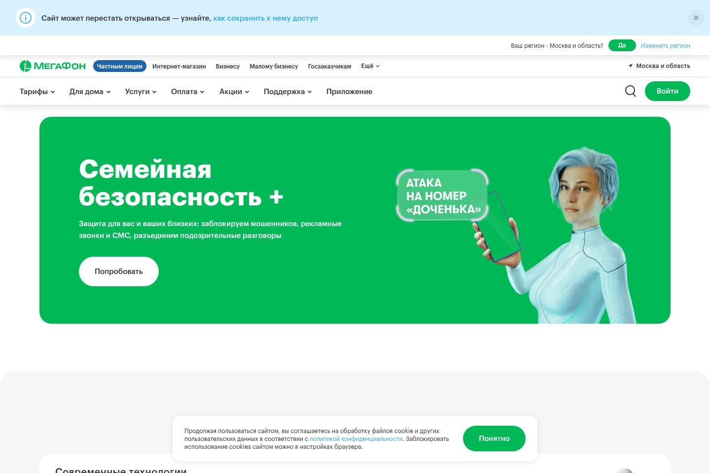
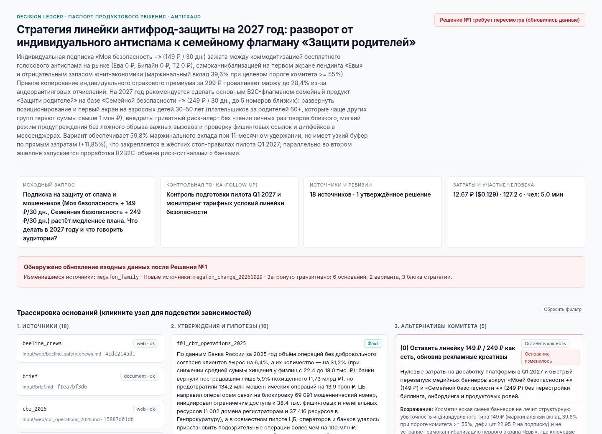
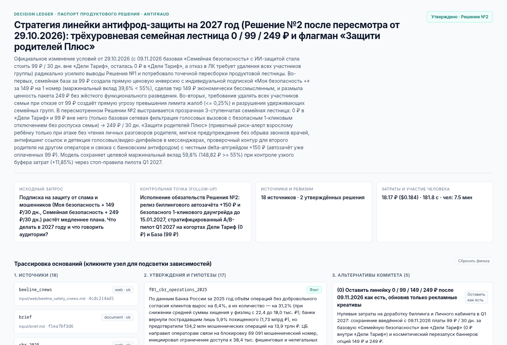
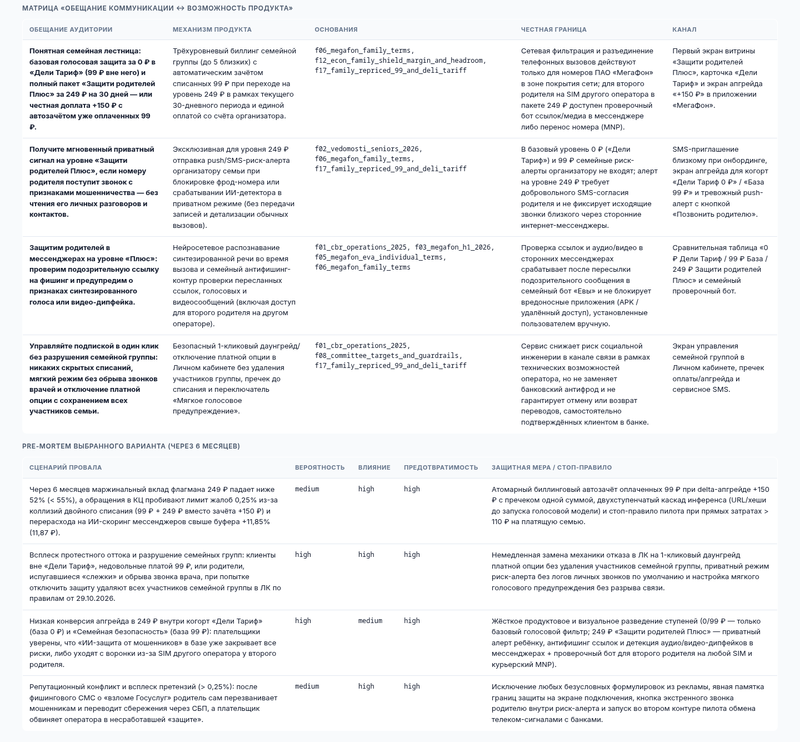

# Демонстрационный проект: стратегия подписки защиты от спама и мошенников на 2027 год

Основной сквозной демонстрационный кейс **Decision Ledger** для номинации «ИИ-проект» («Стратег Фабрики продуктов» от МегаФона), выполненный **исключительно на открытых источниках** в три шага.

> **Как это собрано на самом деле.** Три шага выполнены **субагентами одной родительской сессии Antigravity**: оркестратор передавал каждому субагенту команды и рамки в промпте, состояние между шагами жило только в `.cases/antifraud/case.sqlite3` (истории чата субагенты не видели). Это не три независимых пользовательских чата и не запись живой работы продакта. Протокол настоящего прогона в новых чатах из чистого клона — [docs/live-run.md](../../docs/live-run.md); сырые логи такого прогона кладутся в `runs/<дата>-live-ide/`. Пять вариантов задал руководитель (см. раздел 2).

---

## Быстрый доступ к итоговым документам для жюри

- **Продуктовая стратегия 2027 (Решение №2)**: [strategy-product.md](strategy-product.md) · [strategy-product.pdf](strategy-product.pdf)
- **Коммуникационная стратегия 2027 (Решение №2)**: [strategy-comms.md](strategy-comms.md) · [strategy-comms.pdf](strategy-comms.pdf)
- **Интерактивный паспорт решения (`HTML`, трассировка 18 источников, JTBD, OST, Pre-mortem, матрица обещаний)**: [decision-passport.html](decision-passport.html)
- **Полные выгрузки из реестра**: [03-decision-v1.md](03-decision-v1.md) (Решение №1) · [04-impact-after-20261029.json](04-impact-after-20261029.json) (область пересмотра) · [05-decision-v2.md](05-decision-v2.md) (Решение №2) · [cost.jsonl](cost.jsonl) (пошаговый журнал затрат, замер) · [runs/2026-11-17-antigravity-subagents/measured-telemetry.json](runs/2026-11-17-antigravity-subagents/measured-telemetry.json) (сырая телеметрия хоста) · [benchmark-comparison.json](benchmark-comparison.json) (сравнение с контролем без ledger)

---

## 1. Постановка задачи и проверенные открытые источники

> **Запрос руководителя продукта**: *«Подписка на защиту от спама и мошенников (линейка класса „Моя безопасность +“, 149 ₽ / 30 дней; „Семейная безопасность +“, 249 ₽ / 30 дней поверх ассистента „Ева“) растёт медленнее, чем хотелось бы. Что делать в 2027 году и что говорить аудитории?»* ([brief.md](../../examples/antifraud-subscription/brief.md), рамки комитета — [manager.md](../../examples/antifraud-subscription/manager.md))

| ID в реестре | Тип | Локальный снимок | Первоисточник и ключевые проверенные сведения |
| --- | --- | --- | --- |
| `cbr_2025` | `web` | [cbr_operations_2025.md](../../examples/antifraud-subscription/initial/web/cbr_operations_2025.md) | [Банк России, обзор за 2025 г.](https://cbr.ru/analytics/ib/operations_survey/2025/) — ущерб `29,3 млрд ₽` (`+6,4%`), число операций `+31,2%`, `69 091` номер направлен на блокировку, `38,4 тыс.` фишинговых ресурсов, банки предотвратили `134,2 млн` операций на `13,9 трлн ₽`, смещение атак в мессенджеры и ВПО |
| `vedomosti_2026` | `web` | [vedomosti_seniors_2026.md](../../examples/antifraud-subscription/initial/web/vedomosti_seniors_2026.md) | [Ведомости, 16.02.2026](https://www.vedomosti.ru/finance/articles/2026/02/16/1176754-pensioneri-chasche-drugih-teryali-iz-za-moshennikov-1-mln-rublei) — опрос ЦБ (~460 тыс. чел.): `29%` сталкивались с кибермошенниками, **пенсионеры чаще других теряли суммы свыше `1 млн ₽`** |
| `megafon_eva` | `web` | [megafon_eva_spb.md](../../examples/antifraud-subscription/initial/web/megafon_eva_spb.md) | [МегаФон «Ева»](https://spb.megafon.ru/services/security/eva/) — базовый бесплатный ИИ-ассистент и опция «Моя безопасность +» (`149 ₽ / 30 дн.`) |
| `megafon_family` | `web` | [megafon_family_plus.md](../../examples/antifraud-subscription/initial/web/megafon_family_plus.md) | [МегаФон «Семейная безопасность +»](https://moscow.megafon.ru/lp/protection_cls/) — `249 ₽ / 30 дн.`, до 5 близких с номерами МегаФона, уведомления о попытках мошенничества и выявление дипфейков в мессенджерах |
| `megafon_h1_2026` | `web` | [megafon_h1_2026.md](../../examples/antifraud-subscription/initial/web/megafon_h1_2026.md) | [МСФО МегаФона за H1 2026](https://corp.megafon.ru/press/news/federalnye_novosti/federal/20260821-1500.html) — `79,73 млн` абонентов в РФ (`+1,6%`), сервисная выручка `226,7 млрд ₽` (`+7,9%`) |
| `megafon_annual_2025` | `web` | [megafon_annual_2025.md](../../examples/antifraud-subscription/initial/web/megafon_annual_2025.md) | [Годовой отчёт ПАО «МегаФон» за 2025 г.](https://corp.megafon.ru/download/~federal/corp/investoram/report/year_reports/godovoj_otchet_2025.pdf) (`SHA-256: 30a891d3...`) — `81,89 млн` абонентов группы, фокус на цифровых сервисах безопасности и удержании |
| `mts_cnews`, `beeline_cnews` | `web` | [mts_zashchitnik_cnews.md](../../examples/antifraud-subscription/initial/web/mts_zashchitnik_cnews.md), [beeline_safety_cnews.md](../../examples/antifraud-subscription/initial/web/beeline_safety_cnews.md) | [CNews: МТС «Защитник+»](https://www.cnews.ru/news/line/2025-03-03_mts_predstavila_zashchitnik) (страховка до `1,5 млн ₽`) и [CNews: Билайн «Моя безопасность»](https://safe.cnews.ru/news/line/2025-11-17_bilajn_nazval_tri_shemy_telefonnogo) (бесплатный базовый антиспам и защита звонков в мессенджерах) |
| `tariffs_table`, `economics_spec` | `table`, `document` | [operator_tariffs_2026.csv](../../examples/antifraud-subscription/initial/operator_tariffs_2026.csv), [economics_2027.json](../../examples/antifraud-subscription/initial/economics_2027.json) | Сравнительная матрица большой четвёрки и постатейная модель юнит-экономики вариантов 2027 г. (расчёт — [01-economics.json](01-economics.json)) |
| `eva_ux_png`, `family_ux_png`, `ux_notes` | `ux` | [eva_landing_live.png](../../examples/antifraud-subscription/initial/ux/eva_landing_live.png), [family_plus_landing_live.png](../../examples/antifraud-subscription/initial/ux/family_plus_landing_live.png) | Живые скриншоты публичных лендингов ПАО «МегаФон» и разбор видимых барьеров [ux_observations.md](../../examples/antifraud-subscription/initial/ux/ux_observations.md) |
| `interview_guide`, `synth_personas` | `document`, `synthetic` | [interview_guide.md](../../examples/antifraud-subscription/initial/interviews/interview_guide.md), [synthetic_personas.md](../../examples/antifraud-subscription/initial/interviews/synthetic_personas.md) | Гайд эпизодического интервью и 6 модельных респондентов (`synthetic: true`, `can_cite_as_fact: false` — используются строго для гипотез) |
| `megafon_change_20261029` *(шаг 3)* | `web` | [megafon_family_change_20261029.md](../../examples/antifraud-subscription/later/megafon_family_change_20261029.md) | [Официальное сообщение МегаФона от 29.10.2026](https://moscow.megafon.ru/help/info/popular/information/20261029-0928.html) — с `09.11.2026` базовая «Семейная безопасность» переведена на `99 ₽ / 30 дн.` вне «Дели Тариф» и сохранена за `0 ₽` в «Дели Тариф» |

---

## 2. Шаг 1 (субагент) — Диагностика стагнации, UX-разбор и сравнение 5 альтернатив

1. **Уточнение рамок без лишних вопросов** ([00-intake-questions.md](00-intake-questions.md), маршрут [00-route-intake.json](00-route-intake.json)): агент задал ровно 3 вопроса, меняющих выбор (целевой горизонт и порог маржи `>= 55%`, лимит жалоб на списания `<= 0,25%`, допустимые бизнес-модели).
2. **Что вскрыл анализ открытых источников и живых экранов**:
   - На первом экране бесплатной «Евы» (`eva_landing_live.png`) уже обещано: *«Защищает вас и ваших близких от спама и мошенников. Распознаёт подделанные голоса»* без таблицы отличий платных версий — индивидуальная опция за `149 ₽` страдает от прямой самоканнибализации; при сценарных **допущениях** CAC `260 ₽` и удержания `5 мес.` расчётный маржинальный вклад — **`39,6% < 55%`** ([01-economics.json](01-economics.json)). Порог смены вывода: CAC `<= 145,25 ₽` или удержание `>= 8,95 мес.`
   - На первом экране «Семейная безопасность +» (`family_plus_landing_live.png`) визуальный акцент смещён на детский сценарий (**«АТАКА НА НОМЕР „ДОЧЕНЬКА“»**), тогда как по данным ЦБ РФ и Ведомостей крупнейшие потери (`> 1 млн ₽`) несут **пожилые родители**, которые сами цифровую подписку не покупают.

3. **Сравнение 5 альтернатив комитета.** Честно о происхождении: все 5 направлений перечислил руководитель в прежней версии [manager.md](../../examples/antifraud-subscription/manager.md) (коммит `9aab602`); агент их конкретизировал — цены `299 ₽` со страховкой и `180 ₽` опт, состав затрат, возражения, тесты OST, — а после новости от 29.10.2026 перестроил вариант (2) в лестницу `0 / 99 / 249 ₽` с доплатой `+150 ₽`. Текущий `manager.md` уже без готового списка: самостоятельный поиск вариантов проверяется живым прогоном. Проценты маржи — расчёт на **допущениях** (затраты, CAC, удержание) из [economics_2027.json](../../examples/antifraud-subscription/initial/economics_2027.json); таблица допущений и порогов — в [strategy-product.md](strategy-product.md), раздел 5.1:

| Вариант | Тип | Маржинальный вклад (`CM`) | Сильное возражение (`objection`) | Вердикт |
| --- | --- | --- | --- | --- |
| `(0)` Оставить линейку `149 / 249 ₽` как есть, обновив креативы | `keep` | `39,6%` (на `149 ₽`, ниже порога `55%`) | Не устраняет коммодитизацию голосового антиспама и самоканнибализацию с бесплатной «Евой» | Отклонён |
| `(1)` Включить базовую защиту во все тарифы (`0 ₽`) + премиум со страховкой `299 ₽` | `change` | `28,4%` (из-за страхового андеррайтинга `92 ₽/мес`) | Размывает маржу ниже `55%` и переносит фокус в сложный процесс урегулирования убытков | Отклонён |
| `(2)` Семейный флагман **«Защити родителей»** (`249 ₽ / 30 дн.`) | `change` | **`59,8%`** (`148,82 ₽`, проходит стресс `price -10%`) | Узкий буфер роста прямых затрат (`+11,85%`), этический барьер «слежки» у родителей и ограничение SIM других операторов | **Выбран флагманом** |
| `(3)` B2B2C совместный антифрод с банками (`180 ₽` оптовый rev-share) | `change` | **`62,5%`** (`112,43 ₽`, выдерживает `cost +15%`) | Длинный цикл интеграции и комплаенса (6–9 мес.) — не даст быстрого роста B2C-подписки в Q1 2027 в одиночку | Включён вторым треком R&D |
| `(4)` Закрыть платную B2C-подписку и оставить бесплатный минимум | `close` | `0 ₽` прямой VAS-выручки | Потеря подтверждённой высокомаржинальной ниши семейной заботы на базе `79,73 млн` абонентов | Отклонён |

Агент остановился перед гейтом человека (`stage = review`, без вызова `accept`).

---

## 3. Шаг 2 (субагент) — Проверка MCP, выбор комитета и Решение №1

Во втором шаге новый субагент без истории первого восстановил состояние из `case.sqlite3` как через CLI, так и через стандартный **MCP JSON-RPC 2.0 сервер** ([02-mcp-portability-check.json](02-mcp-portability-check.json)). Продуктовый комитет подтвердил вариант `opt2_family_parents_shield` по хэшу черновика (`pre-accept` хук проверил отсутствие маркетинговых перегибов), кейс проиндексирован в базу знаний SQLite FTS5 (`17` источников, [03-decision-v1.md](03-decision-v1.md), [03-dashboard-v1.html](03-dashboard-v1.html)).

---

## 4. Шаг 3 (субагент) — Поступление новости от 29.10.2026 и транзитивный пересмотр (Решение №2)

В третьем шаге поступает реальное информационное сообщение МегаФона от `29.10.2026` ([megafon_family_change_20261029.md](../../examples/antifraud-subscription/later/megafon_family_change_20261029.md)): с `09.11.2026` базовая «Семейная безопасность» стоит **`99 ₽ / 30 дней`** вне «Дели Тариф» и остаётся **`0 ₽`** внутри «Дели Тариф», а для отключения требуется удалить всех участников группы в ЛК.

1. **Хирургический расчёт области пересмотра ([04-impact-after-20261029.json](04-impact-after-20261029.json))**:
   - Из `16` оснований Решения №1 устарели ровно **`6`** (ценовая лестница семьи, онбординг, прогноз пилота и эластичность), а **`10`** фундаментальных узлов (отчёт ЦБ, демография Ведомостей, МСФО H1 2026, годовой отчёт 2025, конкуренты МТС/Билайн, UX Евы) остались зелёными и не пересчитывались.
   - Автоматически помечены затронутые узлы методологии: `jtbd`, `2` ветки дерева возможностей `OST`, `3` строки `Pre-mortem` и `2` строки матрицы обещаний.

2. **Ключевые продуктовые и коммуникационные изменения в Решении №2**:
   - Устранена ценовая инверсия (`99 ₽` за семью против `149 ₽` за один номер): индивидуальный пакет `149 ₽` выводится из активного продвижения, выстраивается прозрачная 3-ступенчатая лестница: **`Ева 0 ₽`** -> **`Семейная безопасность 99 ₽` (`0 ₽` в «Дели Тариф» — внутрисетевой голосовой фильтр)** -> **«Защити родителей» `249 ₽`** (или **честная доплата `+150 ₽`** поверх `99 ₽` с автозачётом).
   - Устранён триггер разрушения семейных групп: отключение платной опции отвязывается от удаления близких из семейного контура в Личном кабинете.
   - В базу знаний FTS5 записана ревизия `r2`, а ревизия `r1` автоматически переведена в `superseded` с сохранением `can_cite_as_fact: false` ([06-kb-search-sample.json](06-kb-search-sample.json)).

---

## 5. Прозрачность затрат (`cost.jsonl`) и сравнение с контролем без ledger

Все цифры ниже **измерены** из журналов `transcript_full.jsonl` субагентов Antigravity (время по `created_at`, токены по полям `input_tokens`, `cache_read_tokens`, `output_tokens`, вызовы по `tool_calls`); сводка — [measured-telemetry.json](runs/2026-11-17-antigravity-subagents/measured-telemetry.json), построчно — [cost.jsonl](cost.jsonl).

| Прогон | Время | Вызовы инструментов | Входные токены (из них чтение кэша) | Выходные токены |
| --- | --- | --- | --- | --- |
| Шаг 1: постановка, 17 источников, экономика, черновик | `782 с` | `40` | `1 985 344` (`1 610 839`) | `47 327` |
| Шаг 2: восстановление из SQLite, MCP, Решение №1 | `564 с` | `17` | `852 052` (`419 670`) | `10 241` |
| Шаг 3: новость 29.10.2026, пересмотр, Решение №2, стратегии | `1 124 с` | `32` | `2 298 790` (`1 312 700`) | `61 789` |
| **Итого Decision Ledger** | **`2 470 с`** | **`89`** | **`5 136 186`** (`3 343 209`, `65,1%`) | **`119 357`** |
| Контроль без ledger, шаг 1 (ответ по выдержкам) | `318 с` | `17` | `392 671` (`247 906`) | `23 617` |
| Контроль без ledger, шаг 2 (переподача ответа + новость) | `348 с` | `9` | `362 035` (`103 017`) | `22 784` |
| **Итого контроль** | **`666 с`** | **`26`** | **`754 706`** (`350 923`) | **`46 401`** |

- **Что не посчитано и почему**: модель хоста в журнале не указана; работа шла в квоте подписки Antigravity, поэтому стоимость в ₽ **не рассчитывается**; время человека **не измерялось** (рамки и команды передавал оркестратор).
- **Почему нет вывода «дешевле/быстрее в N раз»**: стороны делали разный объём работы — ledger дополнительно проверял MCP, вёл реестр, базу знаний, паспорт и две стратегии. Сопоставимый замер делается живым прогоном по [docs/live-run.md](../../docs/live-run.md) с секундомером.
- **Что сравнимо и проверяемо по тексту** ([benchmark-comparison.json](benchmark-comparison.json)): у контроля ([chat-session-1.md](baseline/chat-session-1.md), [chat-session-2.md](baseline/chat-session-2.md)) локатор первоисточника есть в `18` из `184` абзацев (`9,8%`, счёт `ledger.benchmark_eval`), снимков `SHA-256` — `0`; у Decision Ledger все `17` оснований Решения №2 ссылаются на зарегистрированные снимки (`18` источников с `SHA-256`), проходят `audit-claims`, а после новости граф пометил `6` из `16` оснований к пересмотру (полнота этого множества экспертно не проверялась).
