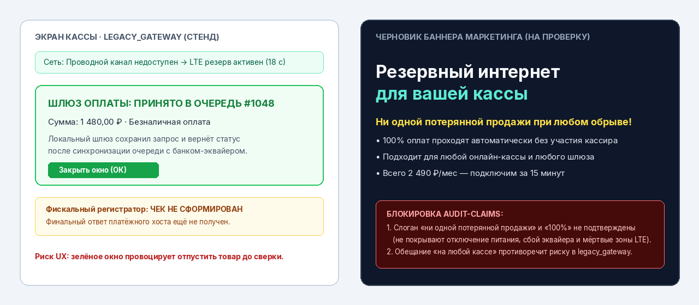
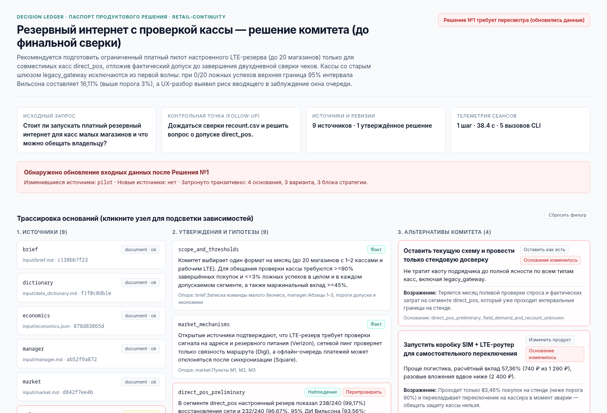
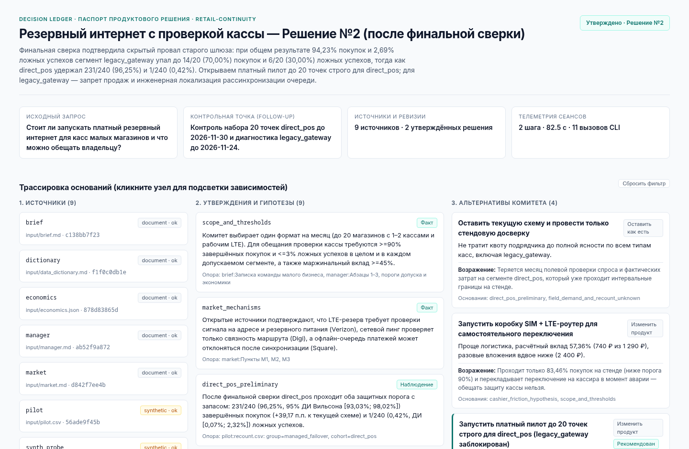
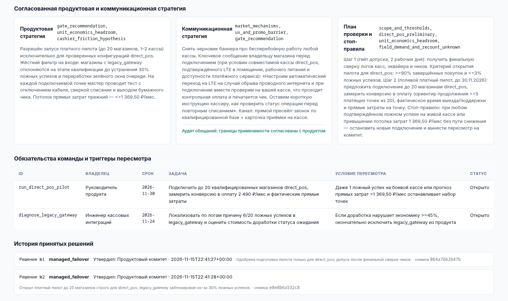

# Демонстрационный проект: резервный интернет с проверкой кассы для малой розницы

Сквозной пример работы агента **Decision Ledger** от неоднозначного продуктового запроса до согласованных продуктовой и коммуникационной стратегий — и пересмотра принятого решения в новом чате после поступления финальной сверки чеков. Все входные материалы основаны на открытых описаниях решений (`Verizon`, `Digi`, `Square`) и явно маркированных учебных данных.

---

## 1. Бизнес-ситуация и входные материалы

Команда малого бизнеса предлагает запустить платный сервис LTE-резерва для магазинов с 1–2 кассами (`2 490 ₽/мес`), чтобы во время сбоев проводной сети касса продолжала принимать безналичную оплату. Руководителю продукта нужно вынести на комитет обоснованное решение и проверить, что именно можно обещать владельцу магазина в коммуникации.

| Входной материал | Тип в реестре | Роль в исследовании |
| --- | --- | --- |
| [brief.md](../../examples/retail-backup/initial/brief.md) | `document` | Запрос продуктовой команды и исходная гипотеза запуска |
| [manager.md](../../examples/retail-backup/manager.md) | `document` | Рамки комитета: до 20 точек, пороги `>= 90%` покупок, `<= 3%` ложных успехов, маржа `>= 45%` |
| [data_dictionary.md](../../examples/retail-backup/initial/data_dictionary.md) + [pilot.csv](../../examples/retail-backup/initial/pilot.csv) | `synthetic` (стенд) | Предварительный срез стендовых испытаний по сегментам касс `direct_pos` (`n=240`) и `legacy_gateway` (`n=20`) |
| [market.md](../../examples/retail-backup/initial/market.md) | `document` | Открытая фактура аналогов (`Verizon LTE Business Internet`, `Digi`, офлайн-очередь `Square`) |
| [economics.json](../../examples/retail-backup/initial/economics.json) | `document` | Тарифы, прямые ежемесячные затраты и разовые расходы на выезд и оборудование |
| [pos_ux_mockup.png](../../examples/retail-backup/initial/pos_ux_mockup.png) + [ux_checkout_notes.md](../../examples/retail-backup/initial/ux_checkout_notes.md) | `ux` | Экран кассы `legacy_gateway` и черновик рекламного баннера маркетинга |
| [synthetic_store_probe.md](../../examples/retail-backup/initial/synthetic_store_probe.md) | `synthetic` | Ролевой опрос модельного владельца магазина (`[SYNTHETIC_PROBE]`) — только для поиска барьеров |
| [recount.csv](../../examples/retail-backup/later/recount.csv) | `synthetic` (сверка) | Финальная сверка журналов касс, эквайера и фискальных чеков (поступает во **втором сеансе**) |

---

## 2. Сеанс 1 — Исследование, защита от ловушки малой выборки и Решение №1

1. **Маршрутизация (`ledger route`)** — [00-route-intake.json](00-route-intake.json): агент отделяет счёт таблиц и юнит-экономики в детерминированный `zero_llm` контур, не тратя токены модели на арифметику, и задаёт комитету только 3 вопроса, меняющих выбор.
2. **Когортная статистика и 95% ДИ Вильсона (`ledger rates --ci --guardrail`)** — [01-rates-initial.json](01-rates-initial.json):
   - В сегменте `direct_pos` (`n=240`) завершено `96,67%` покупок, ложных успехов `0,00%` (ДИ Вильсона `[0,00%; 1,57%] <= 3%` — проходит порог).
   - В сегменте `legacy_gateway` (`n=20`) предварительный срез показывает `0/20` ложных успехов (`0,00%` в точке), но верхняя граница 95% интервала Вильсона равна **`16,11% > 3%`**. Модуль выставляет флаг `masked_segment_uncertainty` и блокирует допуск старого шлюза до полной сверки.
3. **Юнит-экономика и стресс-тест (`ledger economics`)** — [02-economics.json](02-economics.json):
   - Тариф `managed_failover` (`2 490 ₽/мес`, прямые затраты `1 200 ₽/мес`) даёт вклад `1 290 ₽` (`51,81% >= 45%`), но потолок допустимых прямых затрат равен `1 369,50 ₽/мес` — запас прочности всего **`169,50 ₽/мес`** (рост прямых затрат на `+15%` до `1 380 ₽` уже пробивает целевую маржу `45%`).
4. **Разбор UX и аудит обещаний (`ledger audit-claims`)**:

   - На экране `legacy_gateway` зелёная плашка «Принято в очередь» появляется до формирования фискального чека, провоцируя кассира отпустить товар без оплаты.
   - Черновик баннера «Ни одной потерянной продажи при любом обрыве на любой кассе» программно отклоняется `propose --strict-claims`.

5. **Сравнение четырёх альтернатив комитета и утверждение Решения №1**:

| ID альтернативы | Тип | Суть варианта | Ключевое возражение | Статус |
| --- | --- | --- | --- | --- |
| `keep_stand` | `keep` | Оставить стендовую схему без запуска пилота до полной ясности по всем типам касс | Теряется месяц полевой проверки спроса на сегменте `direct_pos`, который уже проходит интервальные границы | Отклонён |
| `self_service_kit` | `change` | Коробка SIM + LTE-роутер для самостоятельного переключения кассиром | На стенде проходит только `83,46%` покупок (`< 90%`) и усиливает стресс сменного кассира в момент сбоя | Отклонён |
| `managed_failover` | `change` | Настроенный LTE-резерв с выездной проверкой кассы (до 20 точек, строго `direct_pos`) | Узкий запас по прямым затратам (`169,50 ₽/мес`) и необходимость подтвердить полевую конверсию в оплату `2 490 ₽/мес` | **Выбран** |
| `close_initiative` | `close` | Закрыть направление и переключить команду на другой продукт портфеля | Отказ от проверки подтверждённого клиентского запроса при наличии рабочего сегмента `direct_pos` | Отклонён |

- Полный текст Решения №1 (Markdown): [03-decision-v1.md](03-decision-v1.md)
- Интерактивный HTML-паспорт Решения №1: [03-dashboard-v1.html](03-dashboard-v1.html)

---

## 3. Сеанс 2 (в новом чате) — Поступление `recount.csv` и транзитивный пересмотр

Через два дня в **новом чате** без истории переписки руководитель передаёт финальную сверку логов касс, эквайера и чеков ([recount.csv](../../examples/retail-backup/later/recount.csv)):

1. **Точечное обнаружение устаревших оснований (`approved_impact`)** — [04-impact-after-recount.json](04-impact-after-recount.json) и [04-dashboard-stale.html](04-dashboard-stale.html): реестр видит смену SHA-256 файла `pilot.csv` и подсвечивает ровно затронутую цепочку (`4` наблюдения/вывода, `3` альтернативы и зависимые блоки стратегии), сохраняя рыночные факты и расчёт базовой экономики без пересчёта.

2. **Детекция маскировки провала средним (`masked_segment_failure`)** — [05-rates-recount.json](05-rates-recount.json):
   - Агрегированный результат `managed_failover` по всей выборке (`n=260`) составляет **`94,23%` покупок** и **`2,69%` ложных успехов** — поверхностный взгляд на общую строку сказал бы, что оба порога (`>= 90%` и `<= 3%`) выполнены.
   - Когортный детектор вскрывает провал внутри `legacy_gateway`: завершённые покупки упали до **`70,00%` (`14/20`)**, а доля ложных успехов выросла до **`30,00%` (`6/20`, 95% ДИ `[14,55%; 51,90%]`)** при `100%` восстановления сети. Сегмент `direct_pos` удержал **`96,25%` (`231/240`)** покупок и **`0,42%` (`1/240`)** ложных успехов.

3. **Утверждённое Решение №2 и согласованные стратегии** — [05-decision-v2.md](05-decision-v2.md) и [05-dashboard-v2.html](05-dashboard-v2.html):
   - Платный пилот до 20 магазинов открывается исключительно для квалифицированных касс `direct_pos` с приёмочным тестом отключения кабеля и выходом бумажного чека.
   - Продажи на `legacy_gateway` блокируются на пресейле; назначается инженерная задача по локализации рассинхронизации очереди до `2026-11-24`.
   - Решение №1 сохраняется в неизменяемой истории ревизий со ссылкой на исходный снимок данных.

4. **Индексация в базу знаний FTS5 (`ledger kb`)** — [06-kb-search-sample.json](06-kb-search-sample.json): первичные документы сохранены с `can_cite_as_fact: true`, синтетический прогон и прошлые выводы агента — с `can_cite_as_fact: false`, а запись Решения №1 помечена `superseded` в пользу Решения №2.
