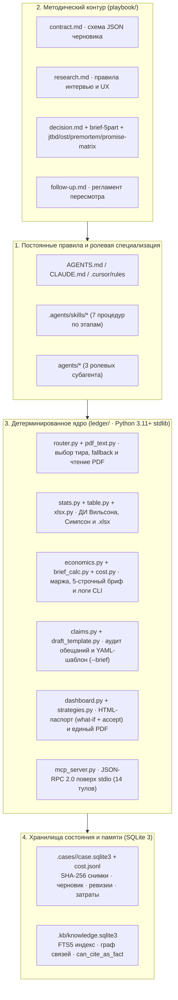

# Архитектура Decision Ledger

Документ описывает внутреннее устройство репозитория, схему хранения состояния, эпистемические инварианты, алгоритмы статистической и экономической проверки и протокол работы MCP-сервера.

---

## 1. Принцип разделения контуров

Обычный диалог с языковой моделью смешивает в одном контекстном окне инструкции, первичные данные, арифметику и прошлые предположения самой модели. При переходе в новый чат эта конструкция распадается, а на длинных задачах приводит к тихим искажениям чисел и раздуванию счёта за токены.

В **Decision Ledger** ответственность разделена между четырьмя независимыми слоями:

---

## 2. Эпистемическая модель и защита памяти

Каждый узел рассуждения (`finding`) обязан иметь явный тип (`kind`) и непустой массив ссылок (`citations`) или граф зависимостей (`depends_on`):

| Тип узла (`kind`) | Что выражает | Допустимая опора |
| --- | --- | --- |
| `fact` | Установленное внешнее сведение (условия регулятора, документация конкурента, параметры договора) | Только первичные источники (`document`, `table`, `web`, реальное `interview`, `ux`) |
| `observation` | Замеренный результат стенда, когортного среза или наблюдаемый элемент интерфейса | Первичные выгрузки, UI-макеты или синтетические пробы (с обязательной маркировкой) |
| `inference` | Логический или расчётный вывод из нескольких фактов и наблюдений | Ссылки на родительские `findings` через `depends_on` (проверяются на отсутствие циклов) |
| `hypothesis` | Проверяемое предположение о барьере клиента, мотивации или причине сбоя | Допускает опору на модельных респондентов (`synthetic`) и косвенные сигналы |
| `forecast` | Ожидаемый количественный эффект пилота или запуска | Требует явного горизонта и плана проверки в `experiment_plan` |
| `assumption` | Принятое до проверки расчётное допущение с границами / порогом переключения | Требует явного способа проверки и условия, при котором команда меняет путь |
| `unknown` | Честно зафиксированный пробел, способный изменить решение | Включается в стоп-правила эксперимента и план действий до получения данных |

### Защита межсессионной базы знаний (`ledger/kb.py`)

При индексации кейса в `.kb/knowledge.sqlite3` каждой записи присваивается неизменяемый класс происхождения (`origin_class`), определяющий флаг `can_cite_as_fact`:

- `primary_evidence` (`can_cite_as_fact = true`) — проверенные документы, таблицы, реальные интервью и UX-материалы.
- `synthetic_probe` (`can_cite_as_fact = false`) — ответы ролевых ИИ-собеседников и синтетические сценарии. Используются только для генерации гипотез и стресс-теста формулировок.
- `prior_conclusion` (`can_cite_as_fact = false`) — ранее принятые решения и выводы самого агента. При выпуске нового решения в том же кейсе старая запись автоматически связывается ребром `supersedes` и переводится в статус `superseded`, чтобы агент в будущих сессиях не выдавал собственный устаревший вывод за первичный факт.

---

## 3. Транзакционный реестр кейса и транзитивный пересмотр

Состояние каждого кейса изолировано в каталоге `.cases/<имя>/` (`case.sqlite3` с транзакциями `BEGIN IMMEDIATE` + построчный журнал `cost.jsonl`):

1. **Побайтные снимки источников (таблицы `state` и `evidence`)**: при регистрации файла через `ledger source` или `ledger fetch` вычисляется `SHA-256` и сохраняется точный побайтный `BLOB` содержимого в таблице `evidence`. Если исходный файл на диске позже обновляется (например, предварительный срез `pilot.csv` заменяется финальной сверкой `recount.csv`), реестр мгновенно фиксирует расхождение хэшей без потери старой версии.
2. **Защита гейта подтверждения (`approval_sha` + `draft_sequence`)**: каждое сохранение черновика (`ledger propose`) увеличивает монотонный счётчик `draft_sequence` и формирует уникальный `approval_sha`. Команда `ledger accept <case> <option_id> --expect <sha>` завершится отказом, если черновик или любой из входных файлов изменился после показа руководителю продукта.
3. **Транзитивный расчёт затронутых выводов (`approved_impact`)**:
   - Находится множество изменившихся или удалённых источников относительно снимка утверждённой ревизии, а также целей `--updates <source_or_finding_id>`, если новые данные зарегистрированы отдельным документом или пресс-релизом без перезаписи старого снимка.
   - По ориентированному ациклическому графу `citations -> findings -> depends_on -> options / strategy / methodology` вычисляется минимальное транзитивное замыкание устаревших узлов.
   - Незатронутые ветки (например, обзор открытых конкурентов и статистика регулятора) сохраняют актуальность и не требуют повторного исследования.

---

## 4. Количественные и проверочные модули

| Модуль | Назначение и математическая модель |
| --- | --- |
| `ledger/stats.py` | Расчёт 95% доверительных интервалов Вильсона для биномиальных долей (корректен при малых `n` и экстремальных исходах `0/n`, `n/n`, где нормальная аппроксимация даёт вырожденный `0%`). Парсер и вычислитель пороговых ограничений `--guardrail metric>=value` (`pass` / `uncertain_small_sample` / `violated`). |
| `ledger/table.py` + `ledger/xlsx.py` | Агрегация CSV/TSV и многолистовых книг OpenXML (`.xlsx`, `stdlib`-парсер `zipfile + ElementTree` с защитой от DTD/XXE и XML-бомб) в целом и по сегментам (`--segment`, `--sheet`), обнаружение парадокса Симпсона (`simpson_reversal`) и маскировки провала средним. |
| `ledger/draft_template.py` | Генерация и компиляция компактных YAML-черновиков (`ledger draft --template`, `propose draft.yaml --strict-claims`) на `stdlib`: автоподстановка 64-символьных `SHA-256` (`reviewed: auto`) и сокращений `cite` / `deps` (реальный первый проход кейса `megakino-plus-2027` занял `20,7 мин = 1 239 с`). |
| `ledger/dashboard.py` | Самодостаточный HTML-паспорт решения без внешних зависимостей: интерактивная трассировка графа, живые ползунки чувствительности `what-if` (`CAC` собственных CVM-каналов vs платного внешнего трафика, `Retention`, рекуррентные затраты и цена строго по формулам `economics.py`) и панель гейта комитета `accept` (копирование команды + 1-клик запись при `--serve` на `127.0.0.1`). |
| `ledger/economics.py` | Детерминированный расчёт юнит-экономики тарифа: `contribution_margin`, `margin_rate`, потолок допустимых прямых затрат `max_allowable_cost` при заданной целевой марже, запас прочности `cost_headroom`, операционная окупаемость разовых вложений и матрица чувствительности (`+15%`, `+25%` к прямым затратам и `-10%` к цене). |
| `ledger/brief_calc.py` + `ledger/pdf_text.py` | Постраничное чтение вёрстки PDF-брифов (`pdftotext -layout` со `stdlib` `zlib`-фолбэком и сканом на `prompt injection`) и детерминированный расчёт продуктового брифа: 14-дневная активация со **всеми созданными группами (включая неотвеченные приглашения) в знаменателе**, сведение доступной базы (`100 тыс.` / `40 тыс.`) без двойного счёта, декомпозиция активных групп, мост валовой прибыли от `279` до `285 млн руб.` по ставке `500 руб./мес.` с календарным потолком `13 - launch_month` и отдельным порогом окупаемости `CAPEX`. |
| `ledger/claims.py` | Статический аудит согласованности продуктовой и коммуникационной стратегий (включая 5 частей `brief_plan`): блокирует безусловные рекламные обещания (`100%`, `всегда`, `ни одной потерянной продажи`, `на любой кассе`), попытки опереть рыночный спрос исключительно на `synthetic`-источники, пропуск ограничений из узлов `unknown` / `assumption` и отсутствие `stop_rule` в плане проверки. |
| `ledger/router.py` | Оценка стадии кейса, модальностей файлов и бюджета (`lean`, `balanced`, `thorough`). Назначает вычислительный тир (`zero_llm`, `fast`, `reasoning`), распознаёт PDF-брифы (`strategic-brief-5part`) и строит детерминированный план обхода сбоев при вызове `--failed-tool` без повторного выполнения уже сохранённых шагов. |
| `ledger/cost.py` | Верифицированный импорт телеметрии рантайма CLI (`ledger cost --from-log`: парсинг `*.stream.jsonl(.gz)` + `turns.jsonl`, `transcript*.jsonl`, `measured-telemetry.json`, Codex `jsonl`) с пересборкой `cost.jsonl` (`verified: true`); ручной самоотчёт модели помечается `verified: false` (`self_reported_unverified`). |
| `ledger/strategies.py` | Выгрузка управленческих документов напрямую из `case.sqlite3`: либо пары `strategy-product.md/.pdf` + `strategy-comms.md/.pdf`, либо **единого 5-частного документа по формату брифа** (`strategy-brief.md/.pdf`, флаг `--only-brief`) с расчётами рядом с решениями через headless Chromium или встроенный `stdlib` PDF-генератор. |

---

## 5. Встроенный MCP-сервер (`ledger/mcp_server.py`)

Команда `python3 -m ledger mcp` запускает стандартный JSON-RPC 2.0 сервер поверх `stdio`, совместимый с Cursor (`.cursor/mcp.json`), Claude Code (`.mcp.json`), Codex и другими MCP-клиентами. Сервер автоматически распознаёт оба варианта кадрирования потока: построчный `NDJSON` и заголовки `Content-Length`.

| MCP-инструмент | Назначение |
| --- | --- |
| `ledger_status` | Состояние кейса, контрольная точка, свежесть файлов по SHA-256 и транзитивный `approved_impact` |
| `ledger_route` | Выбор оптимального следующего процесса, навыка, субагента, тира модели и плана восстановления после сбоя |
| `ledger_rates` | Когортные доли, 95% интервалы Вильсона, проверка `guardrails` и детекция аномалий сегментов по CSV/TSV/XLSX (`sheet`) |
| `ledger_xlsx` | Чтение списка листов и структурированных строк рабочих книг OpenXML (`.xlsx`) в JSON или Markdown на чистом `stdlib` |
| `ledger_economics` | Расчёт маржинального вклада, потолка прямых затрат, окупаемости и стресс-сценариев |
| `ledger_audit_claims` | Проверка соответствия коммуникационных обещаний границам продукта и правилам работы с синтетикой |
| `ledger_kb_search` | Полнотекстовый поиск в SQLite FTS5 с фильтрацией по тегам и эпистемическому классу `origin_class` |
| `ledger_kb_ingest` | Индексация источников и утверждённых решений кейса в межсессионную базу знаний с разметкой `supersedes` |
| `ledger_view` | Рендер утверждённого решения / черновика в Markdown или выпуск интерактивного `dashboard.html` |
| `ledger_export_strategies` | Выгрузка читаемых продуктовой и коммуникационной стратегий или единого 5-частного брифа (`MD` + `PDF`) из `case.sqlite3` |
| `ledger_draft_template` | Генерация компактного YAML-шаблона черновика (`reviewed: auto`, в т.ч. каркаса `brief_plan` при `brief=true`) или компиляция в `proposal` |
| `ledger_pdf` | Постраничное чтение текста и таблиц из PDF-брифов и документов с сохранением вёрстки |
| `ledger_brief_calc` | Детерминированный расчёт 5-строчной витрины брифа, 14-дневной активации (со всеми созданными группами) и моста валовой прибыли по `500 руб./мес.` |
| `ledger_cost` | Импорт сырых логов CLI (`from_log`), сводка и учёт шагов времени, токенов и участия человека в `cost.jsonl` |

Чтение состояния, расчёты, аудит обещаний, база знаний и выпуск паспорта доступны нативно через `stdio MCP`, а транзакционные мутации жизненного цикла (`init`, `source`, `fetch`, `propose`, `accept --expect <sha>`) выполняются через CLI `python3 -m ledger`, удерживая явный гейт подтверждения человека.

---

## 6. Безопасность и гигиена репозитория

- **Защита от prompt injection**: согласно `AGENTS.md`, любое содержимое входных файлов, таблиц и веб-страниц трактуется исключительно как недоверенные данные. Директивы внутри документов изолируются `scan_untrusted_text` и не могут изменить системные правила, ослабить `audit-claims` или обойти подтверждение человека.
- **Контроль утечек (`ledger audit-repo --history` и `hooks/pre-commit`)**: перед коммитом и в CI (`fetch-depth: 0`) проверяются рабочее дерево, сжатые текстовые архивы `.gz` и все блобы git-истории на отсутствие токенов API (`sk-*`, `sk-ant-*`, `xai-*`, `ghp_*`, `AKIA*`, `y0_*`, приватных ключей PEM), мобильных номеров ПДн (`+7/8-9XX`), файлов `.env*`, рабочих баз `.sqlite3` и ошибок синтаксиса JSON.
